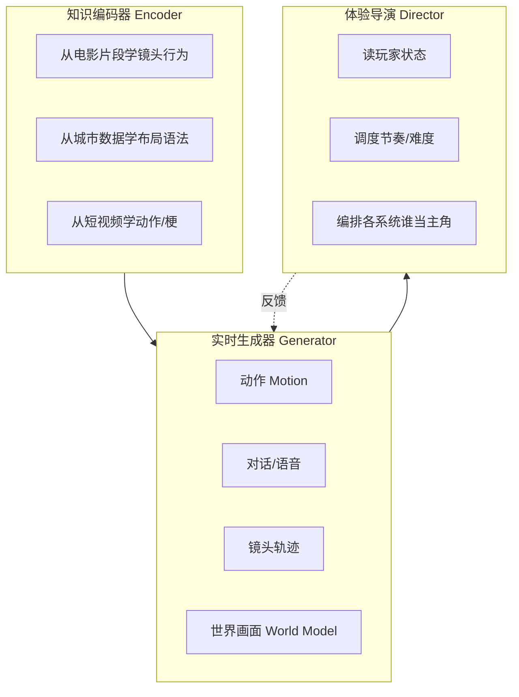

# 00 · 方法论：从专业知识到交互体验

> 把"电影人怎么运镜""城市规划师怎么排布街坊""解说导播怎么切镜头"这类专业知识，变成游戏里能实时运行、而且会对玩家做出响应的系统。

---

## 1. 体验目标分类（先想清楚要什么体验）

在讨论技术之前，先回答：**希望玩家感受到什么？**

| 体验层 | 目标 | 典型手段 | 对应专题 |
|-------|------|---------|---------|
| 感官 | 看得美、听得真、摸得到 | 构图、光影、自适应音乐、触觉 | 01 / 07 |
| 情感 | 紧张、亲密、敬畏、孤独、释放 | 镜头距离、节奏曲线、空间尺度 | 01 / 05 / 02 |
| 认知 | 方向感清晰、信息不过载 | 地标、视线引导、无 HUD 导航 | 02 / 01 |
| 叙事 | 剧情被推进、"我的故事" | 一镜到底、宿敌、记忆 | 01 / 04 |
| 能动 | 创造、表达、"我真是天才" | 系统化规则、涌现解法 | 06 |
| 社交 | 陪伴、炫耀、分享 | AI 队友、舞蹈表情、二创 | 04 / 03 |

> 塞尔达团队给出的体验目标是**"让玩家觉得自己是个天才"**（GDC 2017）；《战神》要的是**"亲密感"**（Cory Barlog）；《对马岛之魂》要的是**"大自然站在你这边"**。**体验目标越具体，技术方案越容易收敛。**

---

## 2. 五步迁移框架

| 步骤 | 关键问题 | 案例 |
|------|---------|------|
| ① 选源领域 | 这个领域能否稳定地制造出某种情感？有没有成文的理论？ | 电影摄影（百年理论）、城市规划（Lynch 1960、Alexander 1977）、体育赛季（每年都在稳定地产出故事） |
| ② 提炼规则 | 能否写成"如果……就……"、语法或约束？ | 电影惯用法（film idioms）→ 分层状态机（Virtual Cinematographer, 1996）；闾里制"五户为比，五比为闾"→ 递归划分算法；化学引擎的三条规则 |
| ③ 可计算化 | 用规则、优化还是学习？ | 规则：形状语法、WFC；优化：Toric Space；学习：从电影片段学习镜头行为（SIGGRAPH 2020） |
| ④ 交互化 | 玩家抢走控制权时怎么办？ | Journey："永远尊重玩家意图"；三分法只在玩家静止时使用；《战神》用快速转身和镜头震动掩盖角色重新站位 |
| ⑤ 体验评估 | 怎么证明体验确实变好了？ | 和平精英：开麦率约 75%、单排玩家参与 AI 队友模式；L4D：按每个玩家估算"情绪强度" |

---

## 3. AI 的三种角色

- **知识编码器**：解决"专业知识难以手写成规则"的问题。例子：Jiang et al. 2020 从电影片段中提取镜头行为，迁移到 3D 动画上；Muse/WHAM 从 7 年等量的游戏录像里学习玩法。
- **实时生成器**：解决"组合数量爆炸、人工做不完"的问题。例子：《异人之下》的 AI 武术过渡动作；Motion Matching 从动捕库中拼接出从未录制过的动作序列。
- **体验导演**：解决"每个玩家每一局都不一样"的问题。例子：L4D Director 的蓄势→高潮→放松循环；DirCast 自动选择电竞直播机位。

> Synactors Guild 提出的"**系统编排（Orchestration）**"概念值得借鉴：导演的工作是决定**此刻由哪个系统承担主要的情感表达**——镜头、声音还是环境。《旺达与巨像》的开场几乎全靠环境表达，其他系统都在克制。

---

## 4. 设计原则（从 GDC 演讲中归纳）

| # | 原则 | 出处 |
|---|------|------|
| 1 | **尊重玩家意图**：玩家想看哪里，镜头就必须转过去 | John Nesky, *50 Camera Mistakes*, GDC 2014 |
| 2 | **乘法优于加法**：少量通用规则 × 大量物体 > 大量专用谜题 | Fujibayashi, BotW, GDC 2017 |
| 3 | **结构化的不可预测**：既不是纯随机，也不是完全确定 | Michael Booth, L4D, GDC 2009 |
| 4 | **"Yes, And"**：永远不要否定玩家做过的事，要在它的基础上继续 | Michael de Plater, Shadow of Mordor |
| 5 | **用分层的简单算法，而不是一个不透明的黑盒** | Booth（"a layered set of extremely simple, playtestable algorithms"） |
| 6 | **美术要"便于撒谎"**：既要可信，又要给玩法留空间 | Takizawa, BotW, GDC 2017 |
| 7 | **AI 是魔术，不是神迹**：效果和幕后人力投入成正比 | Thomas Keane, Dead Meat, GDC 2025 |
| 8 | **AI 只能放大情感投入，不能凭空制造**：先有让人在乎的世界，再接入 AI | State of AI-Native Games, GDC 2026 |
| 9 | **专业顾问 + 亲历者共同参与设计** | Hellblade（神经科学家 + 有幻听经历的人） |
| 10 | **手感原型先行**：先把手感玩出来，再决定是否做成关卡 | Team Asobi, Astro Bot（海绵机制） |

---

## 5. 常见陷阱

| 陷阱 | 表现 | 对策 |
|------|------|------|
| 炫技式 AI | 无限对话，但没有结构、没有节奏、没有后果 | 设计对话的目标和边界（GDC 2026 "mid game" 讨论） |
| 回音室 | 过度个性化，玩家只看到符合自己偏好的内容 | 有意识地注入"意外"和挑战 |
| 一致性崩塌 | NPC 健忘、世界模型回头就变样 | 显式记忆 + 状态机兜底；世界模型只用于短时、非关键体验 |
| 推理成本 | 云端 LLM 难以覆盖亿级 DAU | 端侧小模型（Dead Meat、《异人之下》的 6MB 网络） |
| 同质化 | 大家用同一个模型，生成的东西都差不多 | 用领域规则和本地文化差异化（秦都礼制 vs 西方现代城市） |
| 违背专业常识 | 机械套用电影规则（例如移动中使用三分法导致方向错乱） | 以交互为先，只在合适的状态下应用规则 |
