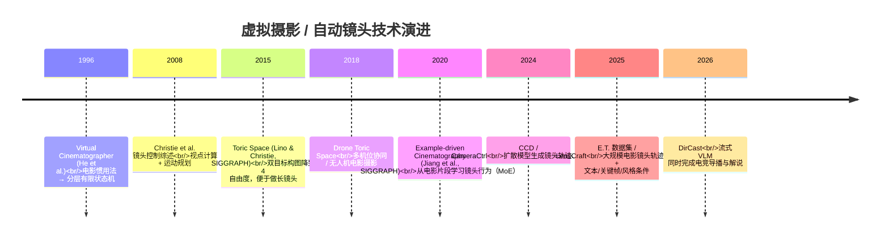

# 01 · 电影化镜头：让镜头会"说话"

> 让镜头不再只是"拉近拉远 + 跟随角色"，而是用来**表达情感、突出信息、推进情节**。
> 技术落地见 `../05_ai_auto_camera/`，本篇聚焦**体验目标、行业案例、AI 技术演进和创新点子**。

---

## 1. 镜头的三种体验功能

| 功能 | 电影手法 | 游戏化挑战 | 案例 |
|------|---------|-----------|------|
| **表达情感** | 景别（特写=亲密）、长镜头（=连续的真实感）、仰拍/俯拍（=权力关系） | 玩家随时会改变站位和朝向 | 《战神》2018 一镜到底，要的就是"亲密感" |
| **突出信息** | 构图引导视线、焦点转移、留白 | 不能遮挡视线，不能让玩家迷失方向 | Journey 飞行时镜头上抬、能量耗尽时下压，提示落点 |
| **推进情节** | 剪辑节奏、视点切换、转场 | 玩法和叙事之间要无缝切换 | 《战神》赫尔海姆船上那场戏：第三人称↔第一人称视点转移 |

---

## 2. 标杆案例拆解

### 2.1 《战神》（2018）一镜到底
- **目标**：Cory Barlog 坚信不切镜能带来"亲密感"，让玩家始终贴近奎托斯和阿特柔斯。
- **代价**：剪辑能重置构图、位置和时间，长镜头不能。于是所有走位必须提前排练；部分镜头长达 4.5 分钟以上（GQ 采访）。
- **方法**：
  - 先用纸面排练，再到真实场地排练；在实拍中发现"用棍子模拟摄像机"不够用 → 开发了更精细的**虚拟摄像机系统**。
  - 战斗阶段转换时，用**快速转身和重击镜头震动**掩盖角色重新站位（Denny Yeh）。
  - 不切镜也可以转换视点：船上的一记重拳把镜头带进奎托斯的暴力回忆，再摇向阿特柔斯的反应。
- **GDC 2019**：Dori Arazi（摄影指导）《深化情感基调与 no-cut 镜头》；Erica Pinto《纪录片式 no-cut 镜头的过场管线》。Santa Monica 共有 19 场相关演讲，PPT 已公开下载。

### 2.2 Journey：动态镜头的 50 个坑
John Nesky（thatgamecompany，"Feel Engineer"）在 GDC 2014 的演讲 *50 Camera Mistakes*：
- 动态第三人称镜头是最难做的，**能用简单的镜头就不要硬上**。
- **永远尊重玩家意图**；系统可以给提示、轻推镜头，但不能禁止玩家转回去。
- **三分法只在玩家静止时使用**，移动时回到中心，否则摇杆方向会和画面错位。
- **不能只靠程序化行为**：在关卡中埋入"镜头提示"，由设计师告诉镜头"这里什么最重要"。
- 唯一的专著：Mark Haigh-Hutchinson《Real-Time Cameras》。

### 2.3 《对马岛之魂》：用自然当 HUD
- 去掉小地图和指针，用"**风之引导**"指向目标；灵感来自《旺达与巨像》举剑指路的设计。
- 风是整部作品的视觉标志，来自早期剑戟片中尘土、烟雾在背景里流动的画面；团队花了 1.5 年让植被和物体对风做出正确反应。
- 地标引导借鉴迪士尼的 weenie（园区中心的高建筑）：狼烟、红枫、飞鸟、萤火虫，以及渐近的蒙古鼓声（GDC 2021，Park Hamilton）。
- **黑泽明模式**：黑白画面 + 胶片颗粒 + 调整过的音频，致敬电影大师。

---

## 3. 自动镜头的技术演进

| 范式 | 原理 | 优点 | 局限 | 游戏适用场景 |
|------|------|------|------|------------|
| 规则 / 状态机 | 把惯用法写成状态 | 可控、性能低 | 僵硬，难以泛化 | 对话、过场、战斗镜头 |
| 优化（Toric Space） | 在屏幕空间约束下求解相机位置 | 精确构图 | 多目标冲突时难调 | 双人对峙、锁定镜头 |
| 示例学习 | 从电影片段提取"镜头特征"并迁移 | **直接迁移电影风格** | 不处理剪辑，数据少 | "让这段战斗拍得像《XX》" |
| 扩散 / LLM 条件生成 | 文本/关键帧 → 轨迹 | 表达力强 | 实时性、可控性差 | 离线过场、回放、预演 |
| 流式 VLM 导播 | 看多路画面，实时决定切换 | 端到端 | 成本高，是新兴方向 | 观战、电竞、高光回放 |

---

## 4. 创新点子库

| # | 点子 | 体验目标 | 迁移的知识 | AI 用法 |
|---|------|---------|-----------|--------|
| C1 | **情绪驱动镜头**：根据血量、敌我距离、剧情节拍自动选择景别和运动 | 紧张 / 释放 | 景别心理学 | 情绪状态机 + 学习得到的权重 |
| C2 | **风格迁移镜头**："这场 Boss 战用《XX》的拍法" | 作者性 | 导演风格 | Example-driven / MoE |
| C3 | **团战自动导播**：多目标 Toric 构图 + 关键事件预测 | 看懂局势 | 体育转播 | 事件检测 + 镜头切换策略 |
| C4 | **高光自动剪辑**：赛后生成带运镜和配乐的短视频 | 炫耀 / 分享 | 剪辑节奏 | VLM 选片 + 轨迹生成 |
| C5 | **无 HUD 引导**：用光、风、动物、声音指路 | 沉浸 + 方向感 | 主题公园 / 电影场面调度 | 规则 + 环境系统 |
| C6 | **视点叙事**：关键时刻切到 NPC 或宿敌的视角 | 共情 | 电影视点切换 | 剧情触发 + 镜头融合 |
| C7 | **一镜到底的自动化**：玩法 ↔ 过场之间的位置自动对齐 | 连续性 | 长镜头调度 | 轨迹优化 + 动作重定向 |
| C8 | **导演模式 UGC**：玩家用自然语言"拍电影" | 创作 | 电影语言 | LLM → 镜头 DSL |

> **MOBA 视角**：俯视角 MOBA 的主镜头不宜做动态化（参考 Nesky 第 1 条），创新空间集中在**观战、回放、高光、击杀特写、英雄登场**这些"非操作时段"，体验收益高、风险低。

---

## 5. 关键资料
- GDC 2014 · John Nesky · *50 Camera Mistakes* — https://gdcvault.com/play/1021262/50-Camera
- GDC 2019 · Santa Monica Studio 演讲合集（含 Dori Arazi、Erica Pinto） — https://sms.playstation.com/stories/our-gdc-2019-presentations-engagement/media/1
- Lino & Christie · *Intuitive and Efficient Camera Control with the Toric Space* · SIGGRAPH 2015 — https://inria.hal.science/hal-01142876v3
- Jiang et al. · *Example-driven Virtual Cinematography by Learning Camera Behaviors* · SIGGRAPH 2020 — https://inria.hal.science/hal-03141673
- LensCraft (2025) 综述了规则、优化、学习三种范式 — https://arxiv.org/abs/2506.00988
- GDC 2021 · Park Hamilton · *Exploration in Ghost of Tsushima: Letting the Island Guide You*（机核中文笔记：https://www.gcores.com/articles/168695）
