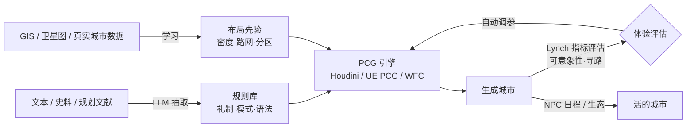

# 02 · 建筑学 / 城市规划 → PCG：生成"讲道理"的城市

> 现有 PCG 规则大多基于**西方现代城市**（陈宇青，腾讯 GDC 2025）。把**建筑学、城市规划、礼制、历史形制**写成规则，生成的城市才会有文化逻辑和"活人感"，玩家也能在里面认路、读出故事。

---

## 1. 可以迁移的知识体系

| 知识来源 | 核心概念 | 转化成什么游戏能力 |
|---------|---------|-----------------|
| Kevin Lynch《城市意象》（1960） | **路径、边界、区域、节点、地标**（五要素）；可意象性 | 寻路、地标层级、无 HUD 导航 |
| Christopher Alexander《建筑模式语言》（1977） | 253 个模式：城镇分布、临水道路、亲密度梯度、高处、树的场所…… | 布局规则库；启发了《模拟人生》 |
| Christopher Totten《An Architectural Approach to Level Design》 | 空间构成、展望 / 庇护、空间情绪 | 关卡情绪设计 |
| 中国古代城市制度 | 闾里制 → 里坊制 → 街巷制；按身份规定的房屋形制、屋顶、是否能临街开门 | 有礼制逻辑的古城生成 |
| 形状语法（Shape Grammar） / CGA | 体块 → 立面 → 构件的递归划分 | 程序化建筑立面 |
| 空间心理学 | 开阔空间（自由 / 脆弱）、狭窄空间（压迫 / 安全）、高处（掌控）、低洼（暴露） | 情绪关卡、战斗区域设计 |
| 主题公园设计 | 迪士尼 weenie（中心高塔）、封闭构图 | 视觉吸引、引导 |

### 空间情绪速查表（Totten / GDC 关卡设计演讲）

| 空间类型 | 情绪 | 适合的玩法 |
|---------|------|-----------|
| 开阔（Prospect） | 自由、孤独、脆弱 | 探索、遭遇战 |
| 狭窄（Narrow） | 幽闭、压迫，有时也是安全感 | 恐怖、潜行 |
| 亲密（Intimate） | 掌控感 | 据点、营地 |
| 高处（Elevated） | 权力、信息优势 | 侦察、狙击 |
| 低洼（Depressed） | 暴露、失去力量 | 伏击、Boss 入场 |
| 方 / 圆 / 尖 | 稳定 / 友好 / 危险 | 建筑与道具的形态语言 |

---

## 2. 标杆案例

### 2.1 腾讯 GDC 2025：程序化重建秦朝古都
- **难点在规则**："强秩序性通常需要复杂的规则来支撑细节"。
- **布局**：依据《周礼》"五户为比，五比为闾"的**闾里制**生成棋盘式布局，再加入尺寸变化打破重复。在 Houdini 中递归划分：输入地块 → 闾里单元 + 内部道路 → 小庭院 → 建筑和墙体 → 群落和 NPC → 回到 UE。
- **官署区**：用动态规划求出最大内接矩形，保证主庭院和英雄建筑有足够的位置；另有"共线编辑模式"。
- **建筑语法**：受《黑客帝国：觉醒》技术演示启发，用字母和符号描述墙体，再配合**图形化语法编辑器**，让美术不用想象语法的视觉效果。
- **屋顶**：把复杂的中式屋顶归纳成单向、双向、交叉双向等类型，加上自适应的 Roof Logic。
- **复用与工具**：建筑模块、建筑模板、合并 / 裁剪、锚定缩放；POI 工具集；云端 Houdini + USD 并行生成，**几分钟就能生成一座大城**，研发提速约 40 倍（媒体报道）。
- 共有 9 个工具：道路、地块、建筑、围墙、缆绳挂饰、行人、河流、农田植被……

### 2.2 Insomniac：《漫威蜘蛛侠》程序化曼哈顿（GDC）
- 道路曲线 → 地面岛 → 设计师用参数定义原始体块 → 模块化构件装饰。
- **以玩法为核心**：在空间里测试蛛丝摆荡路线、天际线是否能引导玩家、区域密度变化是否符合预期。
- **小巷用可编辑曲线**，因为有些小巷要为犯罪和追捕事件专门设计。
- **铁律**：美术和设计师不能直接改生成结果，只能通过参数和输入去影响，否则下次重新生成时手工修改会丢失。

### 2.3 Oskar Stålberg：Bad North / Townscaper
- **WFC（波函数坍缩）**：Maxim Gumin 2016 年提出的约束求解算法（原理类似数独）；在 Bad North 中保证岛屿可通行、海岸线足够长。
- **不规则网格**：三角形 → 随机合并成四边形 → 细分 → 松弛，生成像欧洲老城那样的弯曲街道。
- **Marching Cubes + WFC**：玩家点一下，就会冒出合理的房子、拱廊、支柱。**"建城"本身就是乐趣**——PCG 不只是生产工具，**它就是玩法**。

### 2.4 thatgamecompany：建立认知地图（GDC 2021）
- 讲者 Nicolas Oueijan 曾是建筑师，参与过《Sky 光·遇》；从 Tolman 1948 年的认知地图实验讲到 Lynch 五要素。
- 迷路 = 玩家的认知地图和环境对不上。
- 延伸讨论：**地图界面是可意象性失败的补偿**。《黑暗之魂》没有地图，但玩家能凭记忆画出罗德兰（Lordran）（"The Map Screen as an Admission of Failure"）。

---

## 3. AI 在其中的位置

| AI 能力 | 作用 | 成熟度 |
|--------|------|-------|
| LLM 读史料 → 规则 | "唐长安里坊多大、坊门几时开闭" → 参数 | 🟡 可试点 |
| 图像 / 草图 → 布局 | 美术画色块图 → 路网与地块 | 🟡 |
| 可意象性评估器 | 自动统计地标可见性、区域辨识度、寻路成本 | 🟢 规则即可实现，AI 可增强 |
| 3D 生成模块资产 | 补齐建筑构件库 | 🟢（见 01_aigc_assets） |
| 生成式 Agent 居民 | 有日程、有关系的市民 | 🟡（见 04） |
| 3D 场景生成（Marble 等） | 文本 / 图片 → 可导出的 3D 场景 | 🟡 适合概念阶段 |

---

## 4. 创新点子库

| # | 点子 | 体验 | 迁移知识 |
|---|------|------|---------|
| P1 | **礼制城市**：建筑等级、门的朝向、街巷开闭时间都符合朝代制度，玩家能"读懂"身份秩序 | 文化沉浸 | 里坊制、营造法式 |
| P2 | **自动地标布置**：保证任何位置都能看到一个区域地标（Alexander 第 120 条"路径与目标"） | 方向感 | Lynch / Alexander |
| P3 | **情绪关卡生成**：输入一条情绪曲线（压抑 → 开阔 → 敬畏），输出空间序列 | 叙事节奏 | 空间心理学、教堂序列 |
| P4 | **历史演化城市**：同一座城在不同时代自动"长出"不同形态 | 时间感 | 城市形态学 |
| P5 | **城市即玩法**：玩家拆建、规划，系统保证合理性（Townscaper 式） | 创造 | WFC |
| P6 | **玩法约束优先的 PCG**：先满足蛛丝摆荡、跑酷、攻防的路线，再满足美观 | 掌控感 | 蜘蛛侠管线 |
| P7 | **声景随城市规划生成**：市场喧闹、坊内安静、钟鼓楼报时 | 听觉沉浸 | 声景学 |

> **MOBA 视角**：峡谷地图需要人工精调，不适合 PCG；但**主城 / 大厅 / 局外社交空间 / 英雄故乡**可以采用"礼制 + 可意象性"驱动的 PCG。另外，Lynch 五要素可以直接用来**检查峡谷的可读性**（河道 = 边界、龙坑 = 节点、塔 = 地标）。

---

## 5. 关键资料
- 腾讯 GDC 2025 秦朝古都 PCG（中文整理）：https://www.163.com/dy/article/K14ETB820526DPBA.html ｜ https://news.qq.com/rain/a/20250519A09QXB00
- GDC · *Procedurally Crafting Manhattan for Marvel's Spider-Man*（中文翻译）：https://blog.csdn.net/u013412391/article/details/115217431
- GDC Vault · *Building Blocks: Artist Driven Procedural Buildings*：https://www.gdcvault.com/play/1012655
- *How Townscaper Works*（Game Developer）：http://gamasutra.com/game-platforms/how-townscaper-works-a-story-four-games-in-the-making
- WFC 原始仓库：https://github.com/mxgmn/WaveFunctionCollapse ｜ WFC 技巧：https://www.boristhebrave.com/2020/02/08/wave-function-collapse-tips-and-tricks/
- [GDC 2021] 建立认知地图（中文）：https://igdshare.org/node/3017
- Biggs et al. *Supporting Wayfinding through Patterns within Procedurally Generated Virtual Environments*（Alexander + Lynch 用于 PCG）：http://dwig.lmc.gatech.edu/download/Biggs_SupportingWayfinding_08.pdf
- 书：Totten《An Architectural Approach to Level Design》（第 2 版有日文版）；Lynch《The Image of the City》；Alexander《A Pattern Language》
