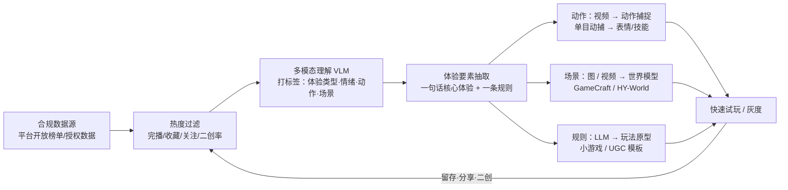

# 03 · 短视频游戏化与世界模型：把"好看"变成"好玩"

> 短视频平台每天都在做一场规模巨大的**体验 A/B 测试**：点击、完播、收藏、关注就是人类注意力的投票。
> **思路**：从高热度视频中识别出"新鲜体验"的要素，**加上交互**，把观看变成游玩。世界模型则让"视频本身就能玩"这件事开始变得可行。

---

## 1. 已被验证的"梗 → 游戏"路径

| 案例 | 原始素材 | 被提炼的体验要素 | 加入的交互 | 结果 |
|------|---------|----------------|-----------|------|
| **《8 号出口》**（KOTAKE CREATE，个人开发） | 网络上的阈限空间 / Backrooms 都市传说、日本地下通道 | "熟悉的地方好像哪里不对"带来的不安 | **找异常：有异常就回头，没有就前进** | 截至 2026-09 销量超 300 万；获日本游戏大奖 Breakthrough 奖；2025 年拍成真人电影；带动一波"找异常"类游戏 |
| **Fortnite 舞蹈表情** | TikTok / 病毒视频里的舞蹈（Floss、Renegade 等） | 身体模仿、社交炫耀 | 一键表情；**击杀后跳舞**成为一种社交语言 | 表情成为核心商品；也引发了原创者署名争议，此后 Epic 开始标注原创者（如 Renegade 的 Jalaiah Harmon） |
| **《和平精英》短剧《想去你的2025》** | 短剧"穿越 + AI 少女"爽剧叙事 | 情感羁绊、角色代入 | **边看边玩**：完成观看任务领取游戏内同款服装，AI 换脸代入角色 | 抖音两周播放量破亿，全网话题量超 4 亿（新华财经） |
| **真人 / AI 互动影游** | 短剧的快节奏和强爽感 | 选择与后果、"偷心"代入 | 分支选择、触碰互动、一元解锁结局 | 《完蛋！我被美女包围了！》2023 年成为爆款；2025–26 年芒果 TV、拼多多、橙光（橙戏 Agent）、腾讯（探梦 DreamNow，据媒体报道）纷纷入局 AI 互动影游 |

> **规律**：成功的案例都只**抽取一个核心体验要素**，并用**一条极简规则**把它交互化（8 号出口只有"回头 / 前进"两个操作）。失败的互动短剧往往是"重流量、轻内容"，留存不如高品质作品（腾讯新闻 2026-04）。

---

## 2. 短视频"新鲜体验"分类与对应玩法

| 体验类型 | 短视频常见形态 | 可以转化的机制 |
|---------|-------------|--------------|
| 奇观 / 视觉冲击 | 极限运动、自然奇观、超大工程 | 体感 / 镜头 / 物理模拟（见 01、06） |
| 异常 / 违和 | 阈限空间、"哪里不对劲" | 找不同、记忆考验、心理恐怖 |
| 解压 / 秩序 | 切割、压碎、整理、完美契合 | 物理破坏、收纳、触觉反馈（见 07） |
| 挑战 / 模仿 | 舞蹈挑战、手势挑战、"你能做到吗" | 动作识别、节奏游戏、表情 |
| 反转 / 悬念 | 剧情反转短剧 | 分支叙事、AI 互动影游 |
| 治愈 / 陪伴 | 萌宠、日常 vlog、ASMR | 养成、陪伴型 AI 角色（见 04） |
| 技艺 / 匠心 | 木工、烹饪、修复 | 模拟经营、工艺小游戏 |
| 社交梗 | 热梗、口头禅、表情包 | 表情系统、语音包、UGC 模板 |

---

## 3. AI 管线设想：从热度数据到可玩原型

| 环节 | 可用技术 | 注意事项 |
|------|---------|---------|
| 热度过滤 | 平台开放数据、榜单 | **必须合规**：遵守平台协议和隐私法规，不做未授权爬取 |
| 多模态理解 | VLM 打标签、聚类 | 标签体系先用第 2 节的分类表 |
| 视频 → 动作 | 单目动捕（无标记点）；腾讯《异人之下》用 7 台小相机、无标记点采集 | **版权和肖像权**：Fortnite 早期舞蹈未署名引发争议 |
| 图 → 可玩场景 | Hunyuan-GameCraft（单图 + 文本 + 动作 → 游戏视频）、HY-World 1.5 | 一致性只能维持数分钟，适合做"体验片段" |
| 规则 → 原型 | LLM 生成小游戏代码 / UGC 模板 | 人工把关"核心规则是否足够极简" |

---

## 4. 世界模型："视频即游戏"的技术底座

| 模型 | 机构 | 时间 | 关键能力 | 开放程度 |
|------|------|------|---------|---------|
| Genie | Google DeepMind | 2024-02 | 从 3 万小时 2D 平台跳跃视频中学习**隐动作**，不需要动作标注 | 论文 |
| GameNGen | Google | 2024-08（ICLR 2025） | 扩散模型在单个 TPU 上以 20fps 实时运行 DOOM | 论文 |
| Oasis | Decart × Etched | 2024-10-31 | 实时运行的类 Minecraft 世界，约 20fps；官方称上线 3 天多用户即破百万 | 开源 500M 权重 |
| Genie 2 | DeepMind | 2024-12 | 单张图生成 3D 可玩环境，10–60 秒一致 | 研究预览 |
| **Muse / WHAM** | Microsoft × Ninja Theory | 2025-02（Nature） | 基于 Bleeding Edge 约 7 年等量的游玩数据，定位为**玩法构思（gameplay ideation）** | 开源 WHAM-1.6B |
| Hunyuan-GameCraft | 腾讯混元 | 2025-06 | 单图 + 文本 + 键鼠动作 → 游戏视频；量化 13B 模型可在 RTX 4090 上运行 | 开源 |
| **Genie 3** | DeepMind | 2025-08-05 | 文本 → 实时可导航世界，720p / 24fps，数分钟一致；**可用提示词触发世界事件**（如改变天气） | 研究预览 |
| Marble | World Labs | 2025-11-12 | 输出**可下载、可编辑的 3D 场景** | 商用 |
| **HY-World 1.5（WorldPlay）** | 腾讯混元 | 2025-12 | 24fps 实时交互；"重构上下文记忆"让走回头路时场景保持一致；文本驱动场景变化；训练数据中 53% 来自 3A 游戏录像 | 开源 |
| GDC 2026 | DeepMind《未来的可玩世界》 | 2026-03 | 现场座无虚席；走通用路线 | — |

**现阶段判断**：
- ✅ **适合**：概念验证、玩法构思（Muse 的定位）、短时奇观体验、"把一张照片变成可走进去的世界"这类社交传播玩法。
- ⚠️ **不适合**：需要长期一致性、精确规则、多人同步的核心玩法。开发者自己也承认，长时间一致性和动作空间仍是主要限制。
- 🔭 **趋势**：世界模型可能先成为**渲染后端 / 预演工具**，再成为玩法本身（GDC 2026 SensAI 展位讨论"把世界模型当作游戏语法的渲染后端"）。

---

## 5. 创新点子库

| # | 点子 | 说明 |
|---|------|------|
| V1 | **爆款体验雷达** | 每周从合规热榜中抽取"体验要素 Top 10"，生成一页可玩性评估 |
| V2 | **视频 → 表情 / 技能** | 热门舞蹈或动作经授权后，通过单目动捕快速生成局内表情 |
| V3 | **照片走进去** | 玩家上传照片，世界模型生成 30 秒的可漫游片段，用于分享 |
| V4 | **短剧 ↔ 游戏双向联动** | 看剧解锁道具，玩游戏的选择反过来决定下一集剧情走向 |
| V5 | **"异常检测"模板** | 把 8 号出口的机制做成 UGC 模板，玩家给任意场景添加异常 |
| V6 | **解压物理小玩法** | 把切割、压碎类短视频的体验做成局外小游戏，配合触觉反馈 |
| V7 | **AI 互动剧情副本** | 用 AI 漫剧管线批量生成分支剧情，作为游戏内的活动副本 |

---

## 6. 关键资料
- 《8 号出口》维基 & 销量：https://wikipedia.com/wiki/Platform_8 ｜ https://labs.invenglobal.com/articles/25663
- Fortnite Renegade 表情与原创者署名：https://screenrant.com/fortnite-renegade-tiktok-dance-emote-creator-credit-jalaiah/
- 游戏"短剧化"（新华财经，2025-03）：https://m.cnfin.com/wx/share?url=//m.cnfin.com/gs-lb//zixun/20250319/4202593_1.html
- AI 互动影游行业综述（腾讯新闻，2026-04）：https://view.inews.qq.com/a/20260408A07UCH00
- Genie 3 对比表：https://aiwiki.ai/wiki/genie_3/revisions/6
- 世界模型调研（2024–2026，中文）：https://huggingface.co/Oratis/world-model-research
- Hunyuan-GameCraft：https://github.com/Tencent-Hunyuan/Hunyuan-GameCraft-1.0 ｜ arXiv 2506.17201
- HY-World 1.5 / WorldPlay：https://github.com/Tencent-Hunyuan/HY-WorldPlay
