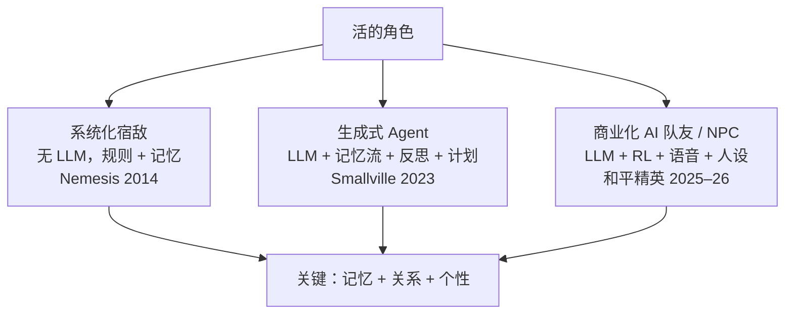
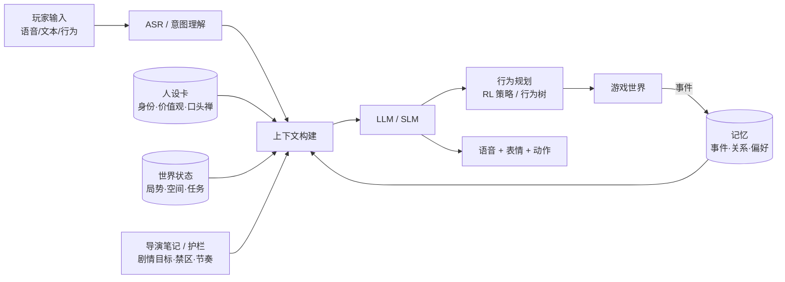

# 04 · 活的角色：有记忆、有动机、会陪伴

> 传统 NPC 的问题：重复台词、没有记忆、你五分钟前打过它，它也不记得。
> AI 角色的价值：**"你和它之间有一段历史"**——这件事本身就是体验。

---

## 1. 三条技术路线

### 1.1 宿敌系统（Shadow of Mordor，2014）—— 不需要大模型的"活人感"
- **动机**：让无名兽人变得令人难忘，"玩家舍不得卖二手盘"。
- **机制**：约 100 个程序化生成的队长，各自有名字、外观、特质和数百条语音；系统**记录你对每个兽人做过的事**（杀死、逃跑、击伤……），兽人再次见到你时会拿这段历史来嘲讽你。
- **死亡即剧情**：杀死你的兽人会升职、变强、去掉弱点 → 自然形成复仇主线。
- **设计参考**：**体育赛季**是"每年稳定产出故事的系统"（选秀 → 常规赛 → 季后赛）；即兴戏剧的"Yes, And"；自我决定理论（胜任、自主、关联）。
- **启示**：先做**身份**（性格设定），再做武器、外观和行为；通过隐藏的"玩家互动分"让玩家熟悉的兽人更容易活下来，聚光灯自然落在玩家在乎的角色身上。

### 1.2 生成式 Agent（Stanford × Google，Smallville，2023）
- 25 个 Agent，每个有一段身份描述 + **记忆流**（记录感知到的一切）+ **检索** + **反思**（把经历总结成更高层的认识）+ **计划**。
- 经典涌现：只告诉一个 Agent"想办情人节派对"，其他 Agent 就自发地传播消息、邀约、布置，最后 5 个 Agent 准时到场。
- 衍生：Parallel Colony 的测试玩家在被告知 Agent 要被重置时感到"失落"，团队因此决定把它做成正式游戏。

### 1.3 商业化落地（GDC 2025–2026）

| 产品 / 演讲 | 要点 | 数据 / 结论 |
|------------|------|-----------|
| **和平精英 AI 队友**（光子，GDC 2026） | 59% 的玩家坚持单排，原因是"怕坑队友、不敢开麦" → AI 队友提供**情绪价值**；嘈杂环境下的语音识别准确率提升到 85%；有长期记忆、会主动鼓励和闲聊；AI 战犬"布鲁斯"能执行"去舔盒子""去咬最近的敌人"之类的指令 | 累计体验用户约 **1.1 亿**，最高日活 **1770 万**，开麦率约 **75%**，每局约 70 轮互动，单排玩家在 AI 队友模式中的占比升到 76% |
| **Dead Meat**（Meaning Machine，GDC 2025） | 从云端 LLM 迁移到**端侧小模型**（NVIDIA ACE）；关键突破是人工编写的"**导演笔记**"来约束对话 | 重复、跑题的问题在云端大模型上同样存在；"AI 是魔术师的戏法，效果和幕后人力成正比" |
| **1001 Nights**（Ada Eden） | 用语言改变世界的创意玩法 | 成本高，依赖模型厂商直接支持 |
| **Covert Protocol**（NVIDIA × Inworld） | 侦探在酒店大堂审问 AI 角色，每局对话都不同 | 技术演示 |
| **Status**（Inworld 生态） | — | 2025 年 2 月公测两周用户破百万（报道） |
| **State of AI-Native Games**（GDC 2026） | 让"AI 本身"成为机制：谈判、欺骗、审讯、说服；"只能靠说话逃出的密室" | **AI 只放大投入，不制造投入**；瓶颈是推理成本和**记忆一致性** |

---

## 2. 角色架构参考

| 组件 | 设计要点 |
|------|---------|
| 人设卡 | 先定义身份，再生成外观和台词（宿敌系统的经验） |
| 记忆 | 只记"关系事件"，而不是全部日志；定期**反思压缩** |
| 导演笔记 | 每个场景写清楚"目的、禁区、节奏"，比换更大的模型更有效 |
| 行为 | 对话由 LLM 负责，**战术由 RL / 行为树负责**，避免让 LLM 直接控制操作 |
| 端云协同 | 高频交互放端侧，复杂推理放云端 |

---

## 3. 创新点子库

| # | 点子 | 体验 | 适配品类 |
|---|------|------|---------|
| N1 | **AI 队友 / 陪练**：读局势、会安慰、会复盘 | 陪伴、降低社交压力 | MOBA / 射击 |
| N2 | **宿敌 2.0**：规则 + LLM 生成台词，敌人记得你上一局的操作 | 个人故事 | 动作 / 开放世界 |
| N3 | **会说话的英雄**：英雄根据你的使用历史改变台词（"又是你选我打野"） | 羁绊 | MOBA |
| N4 | **审讯 / 谈判玩法**：语言本身就是武器 | 新机制 | 推理 / 叙事 |
| N5 | **小镇模拟**：城市居民有日程、八卦、关系网，玩家的行为会被传播 | 活的世界 | 开放世界（结合 02） |
| N6 | **观战 AI 解说**：个性化解说，记得你常用的英雄 | 观赛体验 | 电竞（结合 05） |
| N7 | **AI 主持人 / 跑团 DM** | 即兴叙事 | 社交 / 派对 |

> **MOBA 视角**：和平精英的数据直接说明了**单排玩家**这个隐性核心群体的价值。MOBA 的单排比例同样很高，"AI 队友 / AI 陪练 / 英雄羁绊台词"值得优先验证；战术执行可以用现有的 RL AI，LLM 只负责沟通和情绪。

---

## 4. 关键资料
- Park et al. *Generative Agents: Interactive Simulacra of Human Behavior* (UIST 2023)
- *Designing Shadow of Mordor's Nemesis system*（Game Developer）：https://www.gamedeveloper.com/design/designing-i-shadow-of-mordor-i-s-nemesis-system
- GameLook《如何用"体育式叙事"框架让游戏剧情个性化》：http://www.gamelook.com.cn?p=458424/
- GDC 2025 · *Bringing AI NPCs to Life with NVIDIA ACE: On-Device SLMs in Meaning Machine's Dead Meat*（现场回顾：http://www.invisiblefriends.net/gdc-2025/）
- GDC 2026 回顾（State of AI-Native Games / Executive Panel）：https://lanternworks.dev/lab-notes/gdc-2026-recap
- 和平精英 AI 队友（GDC 2026，中文报道）：https://view.inews.qq.com/a/20260314A07SPA00 ｜ https://view.inews.qq.com/a/20260324A079PN00
