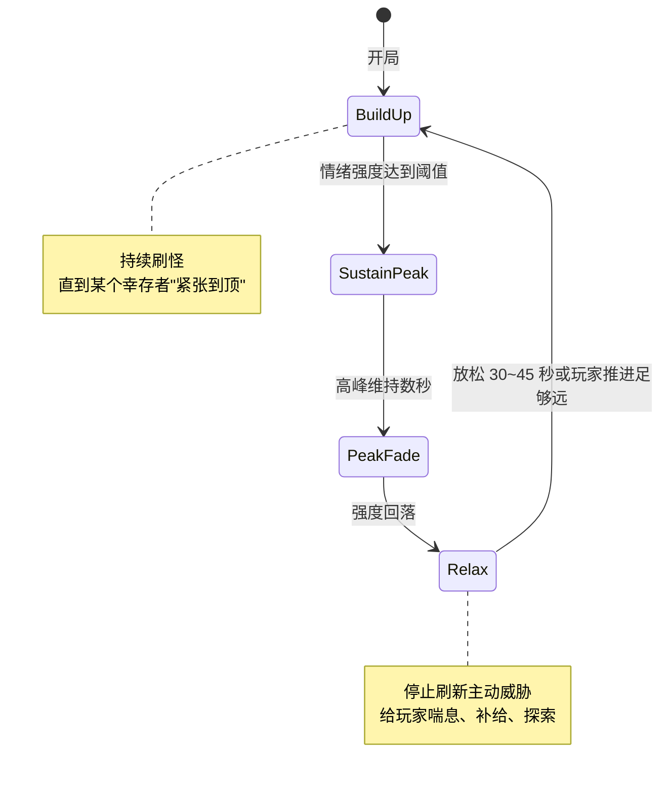
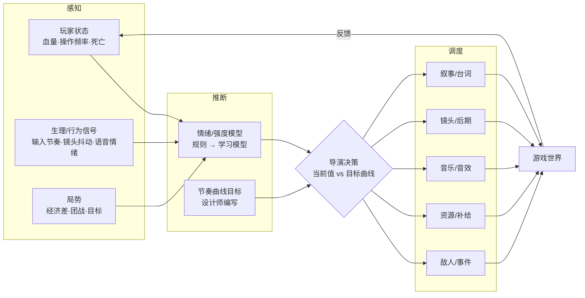

# 05 · AI 体验导演：实时调度紧张度与节奏

> 电影的节奏在剪辑台上就已经定死了；游戏的节奏取决于玩家此刻在做什么。
> **AI 导演**的任务是：**读取玩家状态 → 判断情绪曲线走到了哪里 → 调度敌人、资源、音乐、镜头，让下一段体验"恰到好处"。**

---

## 1. 源领域：节奏是一门专业

| 源领域 | 核心知识 | 迁移到游戏后 |
|-------|---------|------------|
| 电影剪辑 / 编剧 | 三幕结构、张弛交替、"呼吸感" | 战斗与探索交替，高潮之后必须留"喘息" |
| 心理学 | 心流理论（Csikszentmihalyi）：挑战与能力匹配 | 动态难度（DDA） |
| 体育赛季 | 常规赛 → 季后赛 → 总决赛，每年稳定产出故事 | 宿敌系统、赛季叙事（见 04） |
| 桌面跑团（TRPG） | DM 读桌上的气氛，临场改剧情 | 戏剧管理（Drama Management） |
| 主题公园 | 排队区预热 → 主体验 → 出口商店的情绪收束 | 关卡开场 / 结算 / 回城的情绪设计 |
| 电视转播导播 | 多机位切换、慢动作回放、解说节奏 | 电竞自动导播、高光回放 |

---

## 2. 标杆案例

### 2.1 Left 4 Dead AI Director（Valve，2008）—— 行业教科书

- **出处**：Michael Booth，*From Counter-Strike to Left 4 Dead: Creating Replayable Cooperative Experiences*（GDC 2009，GDC Vault 免费）、*The AI Systems of Left 4 Dead*（AIIDE 2009 主题演讲）。
- **设计目标**：**"结构化的不可预测"**（structured unpredictability）。每局的敌人位置、数量和道具都不一样，但节奏始终是"好玩的形状"。
- **核心机制**：

| 机制 | 说明 |
|------|------|
| **情绪强度（Emotional Intensity）** | 每个幸存者单独追踪：受伤、倒地、身边有敌人被击杀都会推高强度，随时间自然衰减 |
| **节奏状态机** | Build Up → Sustain Peak → Peak Fade → Relax 循环；强度到顶就主动"收手" |
| **Active Area Set（AAS）** | 只在玩家附近、**玩家看不见**的区域刷怪，保证"刷出来的东西是合理的" |
| **Flow Distance** | 沿关卡流向计算玩家进度，让刷怪点永远在"前方"或"侧后" |
| **分层的威胁** | 游荡者（氛围）→ 尸潮（压力）→ 特感（打断配合）→ Boss（Tank/Witch，峰值事件） |
| **音乐导演** | 按每个幸存者各自的状态播放音乐层：同一时刻四个玩家听到的音乐可以不同 |

- **Booth 的关键心得**：导演由"**一组极其简单、可以分别做 playtest 的算法叠加而成**"，而不是一个复杂的黑盒。这对今天做 AI 导演仍然是最重要的工程原则。
- L4D2 在此基础上扩展到**动态天气、动态路线**，导演不仅调度敌人，也开始改动关卡本身。

### 2.2 Alien: Isolation（Creative Assembly，2014）—— 双脑结构

- **导演脑**：知道玩家在哪里，维护一个"**威胁值**（menace gauge）"。玩家长时间处于高压状态时，导演会让异形暂时离开，制造喘息。
- **异形脑**：只依靠感官（视觉、听觉）行动，**不会作弊**。导演只给它"大致方向"的提示。
- **启示**：导演负责节奏，角色负责可信度，**两者分离**，玩家就感觉不到"系统在演我"。

### 2.3 RimWorld 叙事者（Ludeon，2018）—— 有人设的导演

- Cassandra Classic（经典张弛）、Phoebe Chillax（长时间放松）、Randy Random（完全随机）三位"AI 叙事者"。
- 玩家**自己选择导演的风格** → 把"节奏偏好"变成了一种可以选择的玩法。
- **启示**：导演的参数可以产品化、人格化，而不仅仅是藏在后台。

### 2.4 Shadow of Mordor 宿敌系统 —— 体育赛季式叙事

- 见 [04_living_characters.md](04_living_characters.md)。从导演的角度看，它的价值在于**长周期节奏**：不是调度某一场战斗，而是调度"整个赛季"的故事。
- 隐藏的"玩家互动分"让玩家关心的兽人更容易活下来 → **聚光灯管理**。

### 2.5 戏剧管理（Drama Management）—— 学术路线

| 项目 | 年份 | 要点 |
|------|------|------|
| **Façade**（Mateas & Stern） | 2005 | 以"剧情节拍（beat）"为单位，导演根据玩家的输入选择下一个节拍，维持亚里士多德式的张力曲线 |
| **Hamlet**（Hunicke） | 2005 | *The Case for Dynamic Difficulty Adjustment in Games*：在 Half-Life 中隐式调整补给 |
| **Experience Management**（Riedl 等） | 2008– | 把玩家体验建模成规划问题，导演在"作者意图"和"玩家自由"之间求解 |
| **EOMM**（Chen 等，EA，WWW 2017） | 2017 | *Engagement Optimized Matchmaking*：以留存为目标的匹配。**伦理争议很大**，见第 5 节 |

### 2.6 电竞自动导播（2025–2026）—— 节奏导演走向观众侧

- **DirCast**（2026，学术）：在 Dota 2 的 27 场比赛上研究导播决策，把导播建模为"**继续保持当前画面 还是 切换**"（hold-or-switch）的序列决策；评估指标同时考虑信息覆盖和观看节奏。
- **LHM.gg Scout AI** 等商业工具：自动识别高光并推荐机位，辅助人类导播。
- **启示**：观赛的节奏同样需要导演，而且观众侧**不影响竞技公平**，是 MOBA 最安全的落地点（与 01 的"自动导播"一致）。

---

## 3. AI 导演通用架构

| 层 | 传统做法 | AI 可以带来的增量 |
|----|---------|----------------|
| 感知 | 血量、死亡次数等硬指标 | 多模态情绪识别（语音语调、输入节奏、视线），**更早、更细**地感知紧张和无聊 |
| 推断 | 手写强度公式 | 用玩家数据学习"什么时候会流失、什么时候会兴奋"，个性化的强度模型 |
| 决策 | 状态机 | 规划 / RL：在设计师给定的曲线和约束内求最优调度 |
| 执行 | 预制刷怪表 | 生成式内容：即时生成事件、台词、音乐片段、镜头 |

> **Booth 原则在 AI 时代依然适用**：AI 负责感知和生成，**节奏的"形状"仍然由设计师用简单、可测试的规则定义**。把整个导演交给一个端到端模型，几乎无法调试。

---

## 4. 创新点子库

| # | 点子 | 体验 | 适配品类 |
|---|------|------|---------|
| D1 | **情绪驱动的全局导演**：同一个强度信号同时驱动镜头（01）、音乐（07）、敌人（本篇） | 统一的"电影感" | 动作 / 射击 |
| D2 | **个人化节奏**：识别"喜欢高压"和"喜欢探索"的玩家，自动调整张弛比例 | 每个人都觉得"刚刚好" | 单机 / PvE |
| D3 | **双脑结构**：导演给提示、角色凭感官行动，避免"系统作弊感" | 可信的恐惧 | 恐怖 / 潜行 |
| D4 | **可选人格的导演**（RimWorld 式） | 节奏偏好变成玩法 | 模拟 / Roguelike |
| D5 | **AI 跑团 DM**：LLM 生成事件和台词，规则层控制节奏曲线 | 即兴故事 | 社交 / 叙事 |
| D6 | **赛季叙事导演**：根据玩家一个赛季的战绩生成"个人赛季故事线"（宿敌、复仇、逆袭） | 长周期的个人故事 | 竞技 / MOBA |
| D7 | **电竞自动导播 + 慢镜头回放** | 观赛节奏 | MOBA / 电竞 |
| D8 | **"喘息"检测**：玩家连续高压后，自动插入安全区、补给、风景镜头 | 防疲劳、防流失 | 所有品类 |

---

## 5. MOBA 视角与伦理边界

**MOBA 是竞技游戏，导演的边界必须划清楚：**

| 可以导演（不影响胜负） | 谨慎导演 | 不应该导演 |
|---------------------|---------|----------|
| 观战 / 回放镜头、导播切换 | PvE / 人机模式的难度与节奏 | 排位赛的伤害、掉落、命中 |
| 音乐、播报、局内氛围 | 新手局的对手强度（需透明告知） | 为留存而"操纵输赢"的匹配（EOMM 式） |
| 结算 / 高光的叙事包装 | 赛季叙事的事件触发 | 对付费玩家的隐性优待 |

- **最佳落点**：团战爆发时，强度信号驱动 **"音乐升级 + 镜头导演 + 播报"** 三件套；团战结束后自动生成高光回放（结合 `05_ai_auto_camera`）。这三件事都只作用于**表现层**，不触碰竞技数值。
- **PvE 模式**（如人机、活动玩法）可以完整使用 L4D 式导演。
- **回音室风险**：GDC 2026 的讨论中有人提醒，过度个性化可能让玩家只看到"系统认为他喜欢的东西"，失去惊喜。导演应当保留一定比例的"**结构化随机**"。

---

## 6. 关键资料

- Michael Booth, *From Counter-Strike to Left 4 Dead: Creating Replayable Cooperative Experiences*（GDC 2009，GDC Vault 免费视频）
- Mike Ambinder, *Biofeedback in Gameplay: How Valve Measures Physiology to Enhance Gaming Experience*（GDC 2011，GDC Vault 免费）——用皮电、心率、眼动感知玩家状态，L4D2 / Portal 2 实验
- Michael Booth, *The AI Systems of Left 4 Dead*（AIIDE 2009 主题演讲，Valve 官网 PDF）：https://steamcdn-a.akamaihd.net/apps/valve/2009/ai_systems_of_l4d_mike_booth.pdf
- Robin Hunicke, *The Case for Dynamic Difficulty Adjustment in Games*（ACE 2005）
- Mateas & Stern, *Façade: An Experiment in Building a Fully-Realized Interactive Drama*（GDC 2003）
- Chen et al., *EOMM: An Engagement Optimized Matchmaking Framework*（WWW 2017）：https://arxiv.org/abs/1702.06820
- Tommy Thompson, *The Perfect Organism: The AI of Alien: Isolation*（Game Developer / AI and Games）
- RimWorld AI Storytellers（官方 Wiki）：https://rimworldwiki.com/wiki/AI_Storytellers
- GameLook《如何用"体育式叙事"框架让游戏剧情个性化》：http://www.gamelook.com.cn?p=458424/
