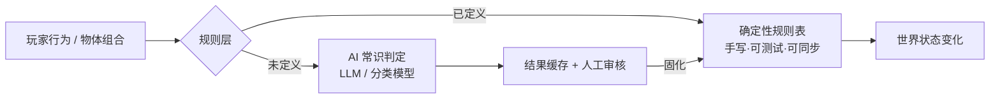
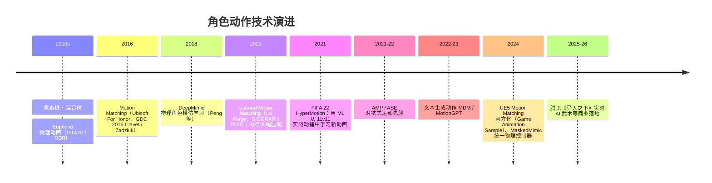

# 06 · 系统化世界与 AI 动作：涌现玩法与"真的在那儿"

> 两类体验在这里汇合：
> - **系统化世界**：少量通用规则互相作用，产生设计师没有逐一预设的玩法（"乘法玩法"）。
> - **AI 动作**：角色的动作对环境和输入实时响应，不再是"播放一段预制动画"。
>
> 二者的共同点：**体验来自规则和模型的实时计算，而不是内容的手工堆砌**——这正是 AI 最擅长放大的方向。

---

## 1. 系统化世界

### 1.1 塞尔达传说：旷野之息（任天堂，GDC 2017）

- **演讲**：*Change and Constant: Breaking Conventions with The Legend of Zelda: Breath of the Wild*（藤林秀麿、泷泽智、堂田卓宏）。
- **两套引擎**：物理引擎（Havok，处理运动与碰撞）+ **化学引擎**（处理元素与材质的状态变化）。
- **化学引擎三条规则**：

| 规则 | 例子 |
|------|------|
| ① 元素可以改变材质的状态 | 火让木头燃烧；冰冻让物体变冷 |
| ② 元素之间可以改变彼此的状态 | 水浇灭火；火融化冰 |
| ③ 材质之间**不能**改变彼此的状态 | 木头碰木头不会发生任何事 |

- **乘法玩法（Multiplicative Gameplay）**：N 种元素 × M 种材质 × K 种动作 → 玩法数量呈乘法增长，而不是"每个谜题只有一种解法"的加法设计。
- 开发早期用 **2D 原型**（类似初代塞尔达的俯视画面）验证化学规则，证明"规则先于内容"。原型里**没有任何谜题**，只有一条规则："给你一个处境和一个目标，你能到达吗？"
- **"说谎的物理"**（堂田卓宏）：游戏需要的不是教科书物理，而是建立在玩家信任之上的"巧妙谎言"——静止（Stasis）、磁力（Magnesis）、攀爬都不是真实物理，但符合直觉，同时提升了可控性和响应性。
- 续作《王国之泪》的究极手 / 余料建造，把"组合"从元素扩展到**物体的物理拼装**。

### 1.2 其他系统化标杆

| 作品 | 系统 | 体验 |
|------|------|------|
| **Dwarf Fortress** | 世界历史模拟（文明、战争、传说） | 每个世界都有独一无二的历史 |
| **Noita** | 每个像素都有物理和化学属性 | 混乱又合理的连锁反应 |
| **Teardown / The Finals** | 体素破坏 / 服务器端同步破坏 | "地形本身就是战术" |
| **Rain World** | 生态系统模拟：生物互相捕食，与玩家无关地生活 | 世界不围着玩家转 |
| **沉浸模拟**（Deus Ex、Prey、Dishonored） | 多系统交叉、多解法 | 玩家的创造力被尊重 |
| **原神元素反应** | 元素 × 元素 → 反应（蒸发、超导……） | 商业化最成功的"化学引擎"之一 |

### 1.3 AI 对系统化世界的增量：从"规则表"到"常识"

传统化学引擎的瓶颈：**每对组合都要人来定义**，规模受限。AI（尤其是 LLM）能提供"常识判定"：

| 案例 | 做法 | 启示 |
|------|------|------|
| **Scribblenauts**（2009） | 人工整理的大型词典 + 属性 | 前 AI 时代的"输入任何物体" |
| **Infinite Craft**（Neal Agarwal，2024） | 用 LLM 判定任意两个元素组合的结果，组合空间近乎无限 | **LLM 作为规则引擎**，玩家以"发现第一个合成出某物"为乐 |
| **State of AI-Native Games**（GDC 2026） | 把谈判、欺骗、说服做成机制 | 语言成为新的"元素" |

> **工程建议**：AI 判定的结果要**缓存并固化**为规则表，避免同一组合每次结果不同，也便于联机同步和回放。

---

## 2. AI 动作：让角色"真的在那儿"

### 2.1 技术演进

### 2.2 关键案例

| 案例 | 要点 | 体验增益 |
|------|------|---------|
| **Motion Matching**（Ubisoft，For Honor / 刺客信条等） | 每帧在大规模动捕库里搜索与当前状态和期望轨迹最匹配的姿势；取代手工连线的状态机 | 起步、转身、急停自然流畅，操作的响应性和真实感同时提升 |
| **Learned Motion Matching**（Holden 等，La Forge） | 用神经网络替代姿势数据库 | 内存占用大幅下降，可以在更多角色上使用 |
| **FIFA 22 HyperMotion**（EA） | 22 名球员同时动捕 + ML 算法实时生成动作 | 球员之间的对抗、卡位"像真的比赛" |
| **物理角色 + RL**（DeepMimic / AMP / MaskedMimic） | 角色在物理仿真中用策略网络维持平衡、完成动作 | 被击中、被推挤、踩到斜坡时**真实的反应**，每次都不一样 |
| **腾讯《异人之下》实时 AI 武术**（GDC 2026 相关报道） | 7 台无标记相机采集武术动作；运行时模型约 6 MB、推理约 0.4 ms；动画制作提效约 75% | 武打招式能根据距离和对手实时衔接 |
| **UE5 Pose Search / Motion Matching** | Epic 官方提供插件和 Game Animation Sample 项目 | 中小团队也能低门槛使用 |

### 2.3 AI 动作带来的"体验"而不只是"提效"

| 维度 | 传统动画 | AI 动作 |
|------|---------|--------|
| 响应性 | 等当前动画播完 | 每帧重新选择/生成，**输入即响应** |
| 环境适应 | 斜坡、台阶靠 IK 修补 | 物理角色天然适应地形 |
| 受击表现 | 几种预制受击动画循环 | 根据受力方向和大小实时反应 |
| 风格化 | 一个角色一套动画 | 同一模型可以通过风格编码生成"醉拳""受伤""疲惫"等变体 |
| 交互对象 | 双人互动要专门动捕 | 学习型模型可以泛化到新的对手和体型 |

---

## 3. 创新点子库

| # | 点子 | 体验 | 适配品类 |
|---|------|------|---------|
| S1 | **技能化学引擎**：技能分成元素和材质，按"三规则"自动推导交互，减少手写的特例 | 乘法玩法、意外的配合 | MOBA / ARPG |
| S2 | **LLM 常识判定 + 规则固化**：玩家尝试新组合，AI 给出合理结果，审核后入库 | 无限的发现感 | 沙盒 / 合成 |
| S3 | **可破坏地形 + 战术涌现** | "地图被打出来"的故事 | 射击 / 竞技 |
| S4 | **物理受击**：根据受力方向、技能类型实时生成受击反应 | 打击感 | 动作 / 格斗 |
| S5 | **风格化移动**：同一套移动动作根据血量、情绪、天气切换风格 | 角色"活"着 | 所有品类 |
| S6 | **生态模拟**：野怪有自己的作息和食物链 | 世界不围着玩家转 | 开放世界 / MOBA 野区 |
| S7 | **文本 / 语音驱动动作**："向他鞠躬""跳一段胜利舞" | 表达自由 | 社交 / 派对 |

---

## 4. MOBA 视角：确定性是第一约束

MOBA 普遍采用**帧同步 / 状态同步 + 录像回放**，这对 AI 动作和 AI 规则提出了硬约束：

| 层 | 要求 | AI 的使用方式 |
|----|------|------------|
| **逻辑层**（位移、碰撞、伤害、技能判定） | 必须确定、可复现，录像回放要逐帧一致 | AI 只能在**离线**阶段使用（例如生成规则表、调参），运行时用定点数和确定性规则 |
| **表现层**（动画姿势、受击表现、特效、镜头） | 只需"看起来对"，可以在客户端各自计算 | Motion Matching、物理受击、风格化动作都可以放在这里 |

- **建议**：AI 动作只驱动**表现层的骨骼姿势**，根运动（root motion）仍以逻辑层位置为准，避免表现与逻辑不同步（这与碰撞系统 M2 "位移与碰撞"的设计一致）。
- **技能化学引擎**（S1）在 MOBA 里最有价值：英雄之间的技能交互（击飞 × 墙体、冰冻 × 火焰）用通用规则推导，可以降低平衡和测试成本，同时制造"意外的配合"。规则本身必须是确定性的表格，AI 只用于离线发现和推荐组合。

---

## 5. 关键资料

- 藤林秀麿等，*Change and Constant: Breaking Conventions with The Legend of Zelda: Breath of the Wild*（GDC 2017）：https://gdcvault.com/play/1024562/ ｜ 官方 YouTube：https://www.youtube.com/watch?v=QyMsF31NdNc
- Simon Clavet, *Motion Matching and The Road to Next-Gen Animation*（GDC 2016）
- Kristjan Zadziuk, *Motion Matching: The Future of Games Animation… Today*（GDC 2016）
- Holden et al., *Learned Motion Matching*（SIGGRAPH 2020）：https://www.theorangeduck.com/page/learned-motion-matching
- Peng et al., *DeepMimic*（SIGGRAPH 2018）；*AMP*（SIGGRAPH 2021）；Tessler et al., *MaskedMimic*（SIGGRAPH Asia 2024）
- Epic Games, *Game Animation Sample Project*（UE 5.4+，Motion Matching 示例）
- Neal Agarwal, *Infinite Craft*：https://neal.fun/infinite-craft/
- 腾讯 GDC 2026 动画相关报道（GameLook / 腾讯新闻）
