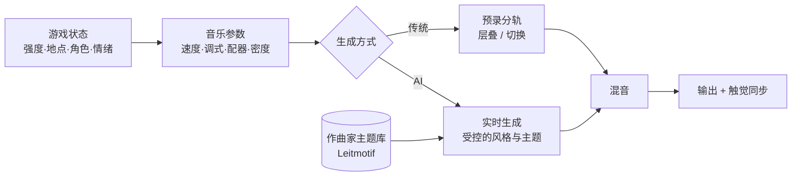

# 07 · 声音、触觉与心理：让体验"进入身体"

> 画面告诉玩家"发生了什么"，声音和触觉决定玩家"感觉到了什么"。
> 这一层的专业知识来自**作曲、声学、神经科学、心理学和人机交互**，在游戏里长期被低估，现有 AIGC 工程也尚未覆盖。

---

## 1. 源领域知识地图

| 源领域 | 核心知识 | 迁移到游戏 |
|-------|---------|----------|
| 电影配乐 | 主导动机（Leitmotif）、情绪铺垫、"声画对位" | 角色主题、自适应音乐 |
| 声学 / 心理声学 | HRTF、双耳录音、遮蔽效应 | 3D 空间音频、"声音定位就是信息" |
| 神经科学 / 精神医学 | 幻听、焦虑、感知失调的现象学 | 心理体验设计（Hellblade） |
| 触觉工程 | 振动频率与材质感、力反馈 | 自适应扳机、触觉波形 |
| 联觉艺术（Synesthesia） | 视觉、听觉、触觉的跨感官映射 | Rez / Tetris Effect |
| 生理测量 | 皮电、心率、眼动 | 生物反馈驱动的导演（Valve） |
| 无障碍设计 | 替代感官通道 | 声音导航、触觉提示 |

---

## 2. 标杆案例

### 2.1 Hellblade: Senua's Sacrifice（Ninja Theory，2017）—— 用游戏传达"精神病的感受"

- **专业合作**：剑桥大学健康神经科学教授 **Paul Fletcher**（精神科医生）担任顾问；项目获得 **Wellcome Trust**（惠康基金会）资助；**有幻听、精神病亲身经历的人**全程参与，反馈"像不像"。
- **双耳音频**：用双耳麦克风录制"脑内的声音"（Furies），戴耳机时声音在耳边、脑后低语、互相争吵——这是**用声学知识直接还原一种主观体验**。
- **视觉感知失调**：图案识别（在环境中"看到"符文）、画面扭曲，对应真实患者描述的症状。
- **结果**：获得 TGA 2017 最佳音效设计、最佳表演、Games for Impact 等奖项；被大量心理健康机构引用。
- **启示**：**把一种难以言说的体验做成可以"亲身经历"的系统**，前提是跨学科合作和真实体验者的参与。

### 2.2 Astro Bot（Team Asobi，2024）—— 触觉作为"第二画面"

- **演讲**：Team Asobi 的 Masayuki Yamada 在 GDC 2025 分享了 DualSense 触觉与自适应扳机的设计（与 Astro's Playroom 的经验一脉相承）。
- **做法**：为不同材质（金属、沙子、冰、水）设计独立的振动波形，脚步落在不同地面上手感不同；自适应扳机模拟弹簧、拉弓、卡顿。
- **工作流**：触觉波形往往从**音频波形**派生和调整，声音设计师和触觉设计师紧密协作。
- **启示**：触觉不是"受击时震一下"，而是**持续的材质感和力感**，可以承载信息（方向、强度、节奏）。

### 2.3 自适应音乐：从 iMUSE 到 AI 实时作曲

| 年代 | 案例 | 机制 |
|------|------|------|
| 1991 | **iMUSE**（LucasArts，Monkey Island 2） | 音乐在场景切换时无缝过渡，按小节对齐 |
| 2008 | **L4D 音乐导演** | 按每个幸存者的状态分别播放音乐层（见 05） |
| 2012 | **Journey**（Austin Wintory） | 音乐随旅程推进而成长，大提琴独奏代表玩家 |
| 2016 | **DOOM**（Mick Gordon） | 战斗强度驱动金属乐分层，GDC 2017 分享 |
| 2018 | **荒野大镖客 2** | 按速度和调式录制分轨，根据玩家行为组合 |
| 2023 | **Hi-Fi Rush**（Tango Gameworks） | 整个世界（敌人、环境、动画）都同步到音乐节拍上 |
| 2025– | **AI 实时音乐生成**（如 Google Lyria RealTime 等） | 可以根据文本/参数实时"引导"的生成式音乐流 |

> **关键约束**：AI 生成必须锚定在作曲家写好的**主题动机**上，否则会失去作品辨识度——"AI 负责变奏，人负责主题"。

### 2.4 联觉与节奏：Rez / Tetris Effect（水口哲也）

- 每一次射击、每一次消除都会产生一个音符或鼓点，**玩家的操作就是在演奏**。
- Rez 甚至推出过配套的"Trance Vibrator"振动设备，Tetris Effect 支持多设备触觉。
- **启示**：跨感官的同步（看、听、摸同时发生）会显著放大"爽感"。

### 2.5 生物反馈（Valve，GDC 2011）

- Mike Ambinder 分享了 Valve 用**皮电反应、心率、眼动**测量玩家状态的实验，在 L4D2、Portal 2、Alien Swarm 中尝试把生理信号接入玩法和测试。
- 今天的可穿戴设备（手表心率）和摄像头情绪识别让这条路线有了新的可能，但必须**知情同意、本地处理**。

### 2.6 无障碍：用其他感官替代视觉

- **The Last of Us Part II**（2020）提供了 60 多项无障碍选项，其中的声音提示和导航辅助让视障玩家能够通关。
- AI 的增量：**实时场景语音描述**、根据玩家能力自动调整提示通道、语音控制。这既是社会责任，也是体验创新。

---

## 3. AI 在感官层的机会

| 方向 | 现状 | AI 增量 | 成熟度 |
|------|------|--------|-------|
| 自适应音乐 | 预录分轨 + 规则切换 | 主题锚定的实时变奏、无限长度的环境音乐 | 中 |
| 音效生成 | 音效库 + 手工调整 | 根据材质 / 动作参数生成拟音（Foley） | 中 |
| 语音 | 预录配音 | 情绪可控的 TTS、实时变声、多语言 | 高（需注意配音演员权益） |
| 触觉 | 手工设计波形 | 从音频 / 物理参数自动生成触觉波形 | 中低 |
| 空间音频 | HRTF 通用模板 | 个性化 HRTF（根据耳廓照片估计） | 低 |
| 情绪感知 | 硬指标 | 语音情绪、输入节奏、生理信号 | 中低 |
| 无障碍 | 固定选项 | 实时场景描述、自适应提示 | 中 |

---

## 4. 创新点子库

| # | 点子 | 体验 | 适配品类 |
|---|------|------|---------|
| A1 | **情绪驱动配乐**：与镜头导演（01）、AI 导演（05）共享一个强度信号 | 声画统一的"电影感" | 所有品类 |
| A2 | **英雄主题变奏**：每个英雄有作曲家写的主题，AI 根据局势实时变奏（劣势时低沉、翻盘时激昂） | 角色认同 | MOBA / 动作 |
| A3 | **材质触觉库自动生成**：从音效和物理材质参数生成触觉波形 | 手感 | 主机 / 手游 |
| A4 | **心理体验游戏**：与心理学家、亲历者共同设计（焦虑、阿尔茨海默、自闭症视角） | 共情 | 叙事 / 严肃游戏 |
| A5 | **操作即演奏**：技能释放与背景音乐节拍对齐，连招形成旋律 | 联觉爽感 | 动作 / 音游 |
| A6 | **AI 声音导航**：为视障玩家实时描述场景、方位 | 无障碍 | 所有品类 |
| A7 | **个性化播报员**：AI 语音播报，记得你的高光（"第三次五杀了！"） | 被看见的感觉 | MOBA / 射击 |

---

## 5. MOBA 视角

- **声音就是信息**：MOBA 里技能音效、脚步声、草丛声都是战术信息，AI 生成的声音必须保证**辨识度优先于丰富度**，关键提示音不能被"变奏"掉。
- **团战音乐升级**（A1 + A2）是低风险、高感知的切入点：只作用于表现层，与 05 中的"音乐 + 镜头 + 播报"三件套一起验证。
- **手游触觉**：移动端振动马达能力参差不齐，可以先在高端机型上做"击杀 / 被控 / 技能命中"的分级触觉，并用 AI 从音效自动派生波形以降低成本。
- **配音权益**：AI 语音要与配音演员协商授权（近年欧美配音演员工会曾因 AI 条款罢工），这是合规前提。

---

## 6. 关键资料

- Ninja Theory, *Hellblade: Senua's Psychosis* 纪录片（官方 YouTube）；Paul Fletcher 相关访谈（Wellcome Trust）
- Mike Ambinder, *Biofeedback in Gameplay: How Valve Measures Physiology to Enhance Gaming Experience*（GDC 2011，GDC Vault 免费）
- Mick Gordon, *DOOM: Behind the Music*（GDC 2017）
- Masayuki Yamada（Team Asobi）, Astro Bot 触觉与 DualSense 设计（GDC 2025）
- Austin Wintory, Journey 配乐相关分享
- Karen Collins, *Game Sound: An Introduction to the History, Theory, and Practice of Video Game Music and Sound Design*（MIT Press, 2008）
- Winifred Phillips, *A Composer's Guide to Game Music*（MIT Press, 2014）
- Naughty Dog, The Last of Us Part II 无障碍选项说明（官方）
