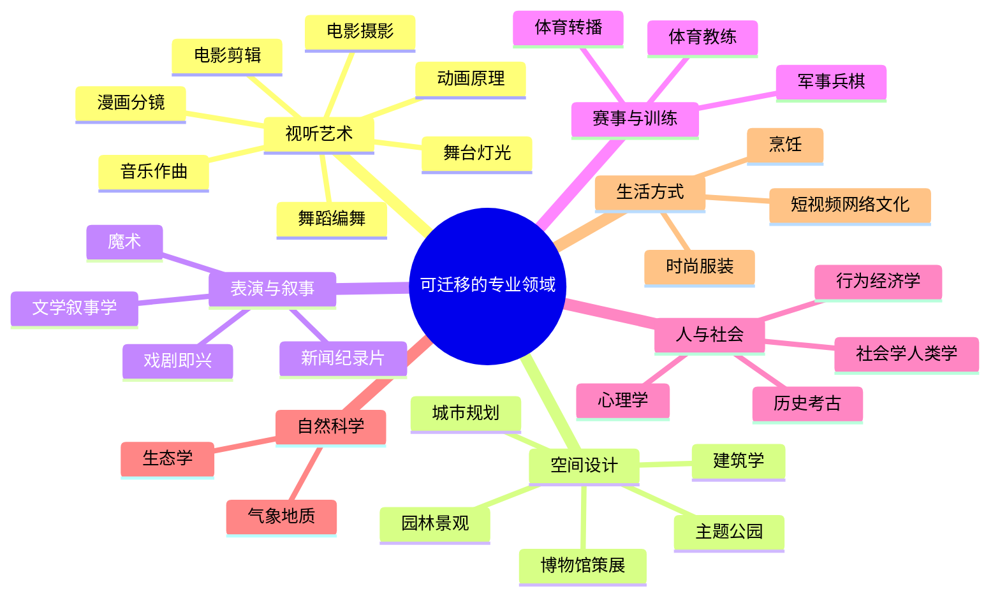

# 08 · 跨领域迁移清单：28 个可以"借知识"的专业领域

> 方法见 [00_methodology.md](00_methodology.md) 的五步框架：**选源领域 → 提炼规则 → 可计算化 → 交互化 → 体验评估**。
> 本篇是第一步"选源领域"的候选池。每个领域都给出：**可迁移的核心知识、游戏里对应的体验、已有案例、AI 能起的作用**。

---

## 1. 全景图

---

## 2. 视听艺术

| # | 源领域 | 可迁移的核心知识 | 游戏中的体验 | 已有案例 | AI 的作用 |
|---|-------|---------------|-----------|---------|---------|
| 1 | **电影摄影** | 景别、机位、运镜语法、180° 轴线 | 情绪化镜头、一镜到底 | 战神（2018）、对马岛之魂 | 从电影片段学习运镜风格，实时生成镜头（→ [01](01_cinematic_camera.md)） |
| 2 | **电影剪辑** | 蒙太奇、匹配剪辑、节奏剪辑、"剪在动作上" | 自动高光集锦、回放剪辑 | 体育转播集锦、电竞赛后集锦 | 自动识别高光 + 按剪辑规则生成短片，直接可分享 |
| 3 | **动画原理**（迪士尼 12 法则） | 预备动作、挤压拉伸、夸张、跟随 | 打击感、顿帧（hitstop）、角色"有分量" | 怪物猎人、街霸的打击感 | 在 AI 生成的动作上自动叠加"夸张"与"预备"，避免"AI 动作太写实而没劲" |
| 4 | **漫画分镜** | 分格节奏、速度线、拟声字、大格强调 | 漫画化的高光、战报、剧情 | Hi-Fi Rush、Comix Zone | 把对局关键帧自动排版成"漫画战报" |
| 5 | **舞台灯光** | 三点布光、色温与情绪、追光 | 用光引导视线、渲染情绪 | 镜之边缘"跑者视觉"（可攀爬物染红）、The Last of Us 用光引路 | 根据情绪目标自动调整灯光参数（→ AIGC `07_ai_rendering_params`） |
| 6 | **音乐作曲** | 主导动机、调式与情绪、配器密度 | 自适应音乐、英雄主题 | Journey、DOOM、L4D | 主题锚定的实时变奏（→ [07](07_senses_audio_haptics.md)） |
| 7 | **舞蹈编舞** | 拉班动作分析（力度、空间、时间、流动） | 风格化动作、表情动作社交 | Fortnite 舞蹈表情、Just Dance | 动作风格迁移；用拉班参数控制"同一动作的不同情绪" |

## 3. 空间设计

| # | 源领域 | 可迁移的核心知识 | 游戏中的体验 | 已有案例 | AI 的作用 |
|---|-------|---------------|-----------|---------|---------|
| 8 | **建筑学** | 形状语法、Alexander 模式语言、空间序列（压缩—释放） | 可信的建筑、空间情绪 | 腾讯秦都、Townscaper | 学习建筑风格并生成规则（→ [02](02_architecture_urban_pcg.md)） |
| 9 | **城市规划** | Lynch 五要素（路径、边界、区域、节点、地标）、坊里制 | 可记忆、可导航的城市 | 蜘蛛侠曼哈顿、刺客信条 | 从真实城市 / 史料提取规划规则 |
| 10 | **园林景观** | 中国园林的借景、框景、障景、移步换景 | "每走几步就有一幅画"的探索感 | 国风开放世界场景 | 自动评估视线与构图，推荐"观景点"和遮挡物摆放 |
| 11 | **主题公园** | 迪士尼的"weenie"（远处的视觉磁铁，如城堡）、强迫透视、排队区叙事 | 地标引导、开场预热 | Scott Rogers《Everything I Learned About Level Design I Learned from Disneyland》（GDC 2009） | 自动检查地标可见性，生成"视觉磁铁"布局 |
| 12 | **博物馆策展** | 叙事动线、展品节奏、"看—读—想"的层次 | 环境叙事、世界观呈现 | Harvey Smith & Matthias Worch《What Happened Here? Environmental Storytelling》（GDC 2010）；刺客信条"探索之旅"教育模式 | 根据世界观设定自动布置环境叙事物件 |

## 4. 表演与叙事

| # | 源领域 | 可迁移的核心知识 | 游戏中的体验 | 已有案例 | AI 的作用 |
|---|-------|---------------|-----------|---------|---------|
| 13 | **戏剧即兴** | "Yes, And"、Keith Johnstone 的地位（status）理论 | 会接戏的 NPC | 宿敌系统、Façade | LLM NPC 的行为准则：先接受玩家行为，再推进（→ [04](04_living_characters.md)） |
| 14 | **魔术** | 误导（misdirection）、强迫选择（forcing）、"效果大于手法" | 惊喜、恐怖、不知不觉的引导 | P.T.、Inscryption、心跳文学部（打破第四面墙） | 实时识别玩家注意力焦点，在视线外布置变化 |
| 15 | **文学叙事学** | 英雄之旅、普罗普 31 种叙事功能、悬念与反转 | 程序化叙事、个人史诗 | Wildermyth、宿敌系统 | 用叙事功能作为骨架约束 LLM 生成，避免"故事散架" |
| 16 | **新闻 / 纪录片** | 纪实视角、证言、真实感 | 纪实游戏、战争中的平民视角 | This War of Mine（受萨拉热窝围城启发）、战神的纪录片式长镜头 | 从史料 / 访谈生成可交互的证言片段（需严格审核） |

## 5. 赛事与训练

| # | 源领域 | 可迁移的核心知识 | 游戏中的体验 | 已有案例 | AI 的作用 |
|---|-------|---------------|-----------|---------|---------|
| 17 | **体育转播** | 导播切换、慢镜头回放、数据图形包装、解说节奏 | 电竞观赛、局内高光 | DirCast、FIFA 的转播式呈现 | 自动导播 + 个性化解说（→ [05](05_ai_director_pacing.md)） |
| 18 | **体育教练** | 刻意练习、即时反馈、录像复盘 | AI 教练、成长感 | 训练软件、电竞复盘工具 | 对局复盘：指出关键失误，给出"下一次怎么做" |
| 19 | **军事 / 兵棋** | OODA 循环、战争迷雾、指挥层级 | 战术深度、信息博弈 | Arma、战略游戏 | 对手建模、战术 AI、"会读你习惯的对手" |

## 6. 人与社会

| # | 源领域 | 可迁移的核心知识 | 游戏中的体验 | 已有案例 | AI 的作用 |
|---|-------|---------------|-----------|---------|---------|
| 20 | **心理学** | 心流、自我决定理论、恐惧与焦虑机制 | 动态难度、心理体验 | Hellblade、L4D | 情绪识别、个性化节奏（→ [05](05_ai_director_pacing.md)、[07](07_senses_audio_haptics.md)） |
| 21 | **行为经济学** | 损失厌恶、禀赋效应、目标梯度 | 奖励设计、收集动机 | 各类成长系统 | **慎用**：只用于提升乐趣，不用于诱导消费 |
| 22 | **社会学 / 人类学** | 社会网络、礼物经济、仪式、匿名合作 | 社交涌现、陌生人善意 | Journey 的匿名同行、EVE Online 的玩家政治 | 模拟 NPC 社会网络与"八卦传播"（→ [04](04_living_characters.md) N5） |
| 23 | **历史 / 考古** | 史料考证、复原方法、礼制 | 可信的历史世界、教育价值 | 腾讯秦都、刺客信条探索之旅 | 从史料提取规则并生成场景（→ [02](02_architecture_urban_pcg.md)） |

## 7. 自然科学

| # | 源领域 | 可迁移的核心知识 | 游戏中的体验 | 已有案例 | AI 的作用 |
|---|-------|---------------|-----------|---------|---------|
| 24 | **生态学** | 食物链、种群动态、生态位 | 活的世界、生态连锁反应 | Rain World、Dwarf Fortress | 生态模拟参数自动调优，保持"既稳定又有变化"（→ [06](06_systemic_world_motion.md)） |
| 25 | **气象 / 地质** | 天气系统、侵蚀、板块 | 动态天气改变玩法、可信的地形 | 塞尔达（雨天无法攀爬、雷暴打金属）、地形生成工具 | 基于物理的天气 / 地形生成，天气影响玩法规则 |

## 8. 生活方式

| # | 源领域 | 可迁移的核心知识 | 游戏中的体验 | 已有案例 | AI 的作用 |
|---|-------|---------------|-----------|---------|---------|
| 26 | **时尚 / 服装** | 搭配规则、色彩理论、潮流周期 | 换装、自我表达 | 无限暖暖（2024） | 穿搭推荐、按描述生成服装 |
| 27 | **烹饪** | 风味搭配、火候、文化菜系 | 合成系统、生活模拟 | 塞尔达的料理系统 | 常识判定任意食材组合的结果（→ [06](06_systemic_world_motion.md) 的 Infinite Craft 思路） |
| 28 | **短视频 / 网络文化** | 爆款结构（钩子 3 秒、反转、可模仿性）、梗的传播 | 梗玩法、可二创内容 | 8 号出口、Fortnite 舞蹈 | 从数据中发现"可游戏化"的爆款（→ [03](03_short_video_world_model.md)） |

---

## 9. 如何挑选源领域：五问清单

| 问题 | 好的信号 | 坏的信号 |
|------|---------|---------|
| ① 这个领域有**成体系的专业知识**吗？ | 有教科书、有术语、有学派 | 只有零散经验 |
| ② 知识能**形式化**吗？ | 能写成规则、参数、评分函数，或有大量数据可供学习 | 只能意会 |
| ③ 迁移后能带来**可感知的体验差异**吗？ | 玩家能说出"感觉不一样了" | 只有开发者看得出来 |
| ④ 需要**实时响应交互**吗？ | 需要（才体现游戏相对电影/建筑的优势） | 离线做一次就够（那是提效，不是增效） |
| ⑤ 有没有**可以合作的专家**？ | 可以请到摄影师、建筑师、心理学家 | 只能靠自学 |

---

## 10. 对 MOBA 业务的优先候选

| 优先级 | 源领域 | 理由 |
|-------|-------|------|
| ★★★ | **体育转播 + 电影剪辑**（#17、#2） | 观赛 / 回放 / 高光分享，只作用于表现层，不影响公平；与 `05_ai_auto_camera` 直接衔接 |
| ★★★ | **体育教练**（#18） | AI 复盘对单排玩家价值很高，可以复用现有 RL AI 的局面评估能力 |
| ★★☆ | **音乐作曲**（#6） | 团战音乐升级、英雄主题变奏，低风险、高感知 |
| ★★☆ | **戏剧即兴 + 文学叙事**（#13、#15） | 英雄羁绊台词、赛季个人故事线 |
| ★★☆ | **园林 / 主题公园**（#10、#11） | 地图美术与视线设计（需要在竞技可读性的前提下） |
| ★☆☆ | **漫画分镜**（#4） | 漫画战报，适合社交传播 |
