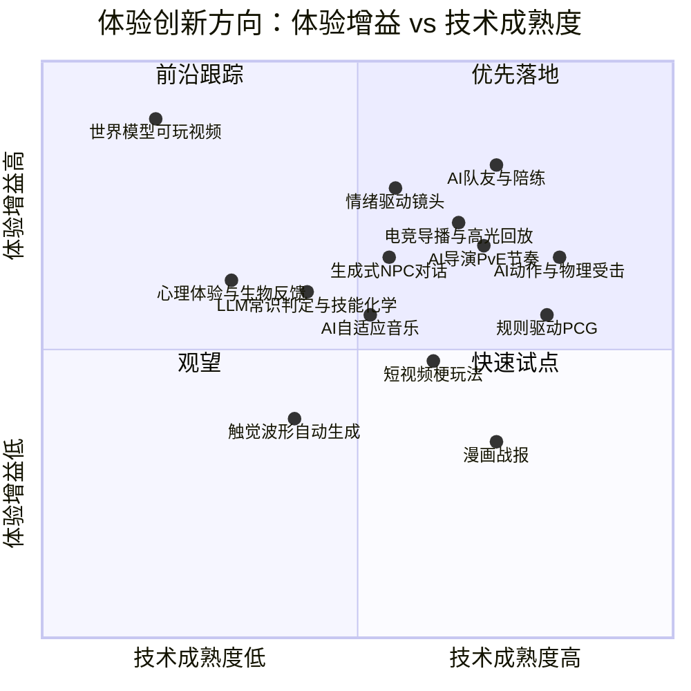
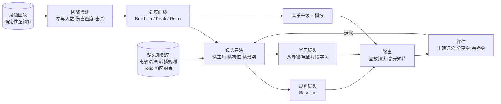

# 10 · 机会矩阵：体验增益 × 技术成熟度，以及落地建议

> 把 01–08 中的方向放到同一张图上比较，回答三个问题：
> 1. **哪些现在就能做？** 2. **哪些值得长期跟踪？** 3. **对本工程和 MOBA 业务，主线该选哪条？**
>
> 评分为基于公开资料的定性判断（1–5 分），用于讨论排序，不是精确度量。

---

## 1. 机会矩阵

| 象限 | 方向 | 策略 |
|------|------|------|
| **优先落地**（高增益 × 较成熟） | AI 队友/陪练、电竞导播与高光回放、情绪驱动镜头、AI 导演（PvE）、AI 动作、生成式 NPC 对话 | 立项做闭环验证 |
| **前沿跟踪**（高增益 × 不成熟） | 世界模型可玩视频、心理体验/生物反馈、LLM 常识判定 | 小规模预研，关注论文和开源进展 |
| **快速试点**（中低增益 × 成熟） | 规则驱动 PCG、短视频梗玩法、漫画战报 | 作为运营活动或工具快速试，不占主线 |
| **观望** | 触觉波形自动生成 | 等待硬件和工具链成熟 |

---

## 2. 详细评分

| 方向 | 来源 | 体验增益 | 成熟度 | 成本（5=低） | MOBA 公平风险（5=无风险） | 与本工程复用 | 总分 |
|------|------|:---:|:---:|:---:|:---:|:---:|:---:|
| **电竞导播与高光回放** | 01 / 05 | 4 | 4 | 4 | **5** | **5**（05_ai_auto_camera） | **22** |
| **情绪驱动镜头** | 01 | 4 | 3 | 3 | **5** | **5** | **20** |
| 规则驱动 PCG | 02 | 3 | 4 | 3 | 4 | 4（03 PCG） | 18（但 MOBA 地图固定，适用面窄） |
| AI 队友 / 陪练 | 04 | 5 | 4 | 2 | 3 | 3（08 Agent） | 17 |
| 团战音乐升级 | 07 | 3 | 3 | 4 | 5 | 2 | 17 |
| AI 复盘教练 | 08 | 4 | 3 | 3 | 5 | 2 | 17 |
| AI 动作与物理受击 | 06 | 3 | 4 | 3 | 4（仅表现层） | 3（01 资产/动画） | 17 |
| 英雄羁绊台词 / 赛季故事线 | 04 / 05 | 3 | 3 | 3 | 5 | 2 | 16 |
| 技能化学引擎 | 06 | 4 | 2 | 3 | 3（影响平衡） | 2 | 14 |
| 世界模型可玩视频 | 03 | 5 | 1 | 1 | 5 | 1 | 13 |

> **结论**：对 MOBA 而言，**"镜头 + 导播 + 回放"** 在五个维度上最均衡——体验可感知、技术可落地、不碰竞技公平、能直接复用 `05_ai_auto_camera` 的积累。

---

## 3. 推荐主线：MOBA 团战高光与回放的"AI 导演镜头"

### 3.1 为什么是它

| 理由 | 说明 |
|------|------|
| **体验可感知** | 团战是 MOBA 情绪最高的时刻，镜头表现直接决定"爽不爽、想不想分享" |
| **零公平风险** | 只作用于观战、回放、结算高光，不改变任何逻辑数据 |
| **数据天然齐全** | 录像回放系统记录了完整的逻辑帧，**可以对同一场团战反复"重拍"**，非常适合算法迭代和 A/B 评估 |
| **知识可迁移** | 电影摄影（01）+ 体育转播（08 #17）+ 剪辑（08 #2）都有成熟的语法 |
| **工程衔接** | `05_ai_auto_camera` 已有电影摄影与游戏镜头的资料基础（`01_film_cinematography`、`02_game_camera`） |

### 3.2 闭环架构

### 3.3 分阶段计划

| 阶段 | 目标 | 内容 | 验收标准 |
|------|------|------|---------|
| **P0 数据与检测** | 从回放中找出"值得拍"的时刻 | 团战检测、关键事件标注（首杀、多杀、反杀、抢龙）、强度曲线 | 与人工标注的高光重合度达到可用水平 |
| **P1 规则镜头** | 做出可解释的 Baseline | 主角选择（对强度贡献最大的单位）、Toric 式构图约束、景别切换规则、轴线规则（参考 Nesky 50 条） | 设计师主观评分优于固定俯视镜头 |
| **P2 导播与剪辑** | 从"一个镜头"到"一段片子" | hold-or-switch 切换策略（参考 DirCast）、慢镜头、剪辑节奏，自动生成 15–30 秒高光短片 | 高光短片的分享率、完播率 |
| **P3 学习镜头** | 引入风格 | 从职业比赛导播、电影片段中学习镜头行为（参考 Example-driven 2020、LensCraft 2025），支持"史诗""热血""搞笑"等风格 | 风格可区分、可控 |
| **P4 多感官统一** | 声画一体 | 强度信号同时驱动音乐升级（07 A1/A2）和播报（07 A7） | 用户调研中"电影感"评分提升 |
| **P5 实时化** | 从回放走向实时观战 | 观战模式实时导播；局内（仅限表现层）轻量镜头强调 | 延迟与性能达标 |

### 3.4 评估指标

| 层面 | 指标 |
|------|------|
| 主观体验 | 设计师 / 玩家评分（信息清晰度、情绪强度、电影感）；A/B 盲测 |
| 行为数据 | 高光短片的生成量、分享率、完播率、二创量 |
| 镜头质量 | 主角在画面内的比例、遮挡率、轴线违规次数、切换频率（参考 Nesky 50 条做成自动检查项） |
| 工程 | 单场回放的处理耗时、运行时开销 |

---

## 4. 与现有 AIGC 方向（00–10）的结合点

| 现有方向 | 结合的体验创新 | 结合方式 |
|---------|-------------|---------|
| `01_aigc_assets` | 06 AI 动作、07 音乐/音效 | 资产生成 → 运行时生成；动作资产用于 Motion Matching 库 |
| `02_ai_coding` | 全部 | 用 AI Coding 加速原型（导演规则、镜头规则的快速迭代） |
| `03_pcg_scene_generation` | 02 建筑/城市规则 | 补充"领域规则层"：礼制、Lynch、Alexander |
| `04_ai_auto_testing` | 05 AI 导演、10 镜头评估 | 自动测试 Agent 跑大量对局 → 为导演和镜头提供数据；镜头质量自动检查 |
| **`05_ai_auto_camera`** | **01 镜头、05 导演、08 转播/剪辑** | **主线：本篇第 3 节** |
| `06_asset_pipeline_adaptation` | 06 动作 | 动捕数据清洗、Motion Matching 数据库构建 |
| `07_ai_rendering_params` | 08 #5 舞台灯光 | 根据情绪目标自动调整灯光、后期参数 |
| `08_ai_agent_workflow` | 04 活的角色、05 AI 导演 | Agent 从研发工具走进游戏运行时 |
| `09_experiments` | 前沿跟踪象限 | 世界模型、LLM 常识判定的小实验 |
| `10_resources` | 09 资料清单 | 资料互相索引 |

---

## 5. MOBA 业务落地清单

| 场景 | 推荐方向 | 公平性 | 优先级 |
|------|---------|-------|-------|
| 观战 / 回放 / 高光 | AI 导演镜头 + 自动剪辑 + 音乐 | 无影响 | ★★★ |
| 单排玩家体验 | AI 队友沟通（LLM）+ 战术执行（RL） | 需在独立模式或人机局中使用 | ★★★ |
| 赛后成长 | AI 复盘教练 | 无影响 | ★★☆ |
| 局内表现 | 英雄主题音乐变奏、Motion Matching 移动、物理受击（仅表现层） | 无影响（逻辑层保持确定性） | ★★☆ |
| 长线留存 | 赛季个人故事线、英雄羁绊台词 | 无影响 | ★★☆ |
| 社交传播 | 漫画战报、梗玩法活动 | 无影响 | ★☆☆ |
| PvE / 活动模式 | L4D 式 AI 导演 | 仅限非竞技模式 | ★☆☆ |
| 玩法创新预研 | 技能化学引擎（离线发现组合 + 确定性规则表） | 影响平衡，需严格验证 | 预研 |

---

## 6. 主要风险

| 风险 | 表现 | 应对 |
|------|------|------|
| **同质化 / "AI 味"** | 所有游戏的镜头和台词都差不多 | 以作品自己的风格数据训练；人写主题，AI 做变奏 |
| **失控** | 镜头乱切、NPC 说错话 | 规则护栏 + 导演笔记 + 人工兜底（Dead Meat 经验） |
| **确定性被破坏** | 回放不一致、联机不同步 | AI 只在表现层或离线使用 |
| **公平与伦理** | 操纵匹配、诱导消费 | 明确红线（见 05 第 5 节）；不做 EOMM 式优化 |
| **版权与授权** | 梗、舞蹈、配音、训练数据 | 合规审核，原创者署名与授权（见 03、07） |
| **推理成本** | 大模型运行时成本高 | 端云协同、小模型蒸馏、结果缓存 |
| **评估困难** | "体验好不好"难以量化 | 主观评分 + 行为数据 + 自动检查三者结合 |

---

## 7. 一页结论

1. **增效的方法论**：找到成熟的专业领域 → 把知识形式化 → 让 AI 实时执行 → 用体验指标评估。
2. **现在就能做**：AI 队友、AI 导播镜头、AI 动作、PvE 导演——都有商业案例或成熟技术。
3. **长期跟踪**：世界模型、LLM 常识判定、生物反馈。
4. **本工程主线**：`05_ai_auto_camera` × MOBA 团战高光与回放，按 P0–P5 逐步推进；录像回放的确定性让"反复重拍同一场团战"成为可能，这是最适合迭代镜头算法的试验场。
