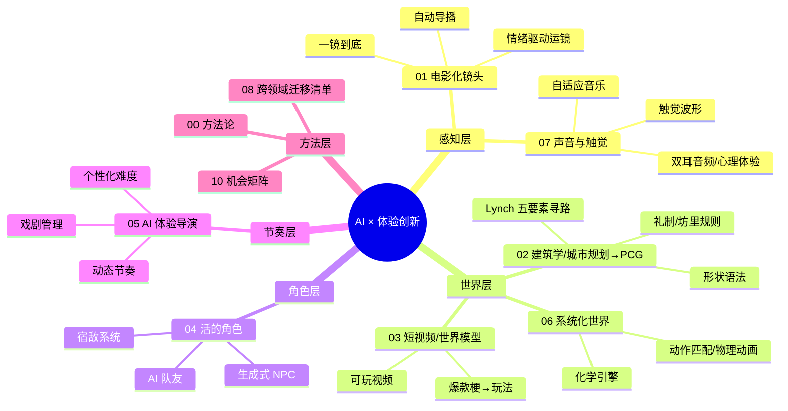

# 11 · AI 驱动的游戏效果与体验创新

> **核心命题**：游戏是一门创新的艺术。AI 在游戏研发里除了**提效**（让同样的东西做得更快），更重要的价值是**增效**——让玩家获得以前做不出来、或者成本高到没人去做的**新效果、新体验**。
>
> **核心方法**：把**成熟的专业领域知识**（电影摄影、建筑学、城市规划、体育转播、心理学、戏剧、音乐……）**形式化**，借助 AI **变成可以实时计算、能对玩家交互做出响应的游戏系统**。
>
> 资料检索时间：2026-11-02｜来源：GDC Vault / SIGGRAPH / arXiv / 厂商技术博客 / 行业媒体（详见 [09_gdc_reading_list.md](09_gdc_reading_list.md)）

---

## 1. 提效与增效：两条路线对比

| 维度 | 提效（00–10 方向的主线） | **增效（本目录）** |
|------|------------------------|------------------|
| 目标 | 降低成本、缩短周期 | 带来新的体验，提升情感强度 |
| 衡量指标 | 人天、产能、返工率 | 情绪曲线、沉浸感、留存、二创量、口碑 |
| AI 的角色 | 替代重复劳动 | **专业知识的载体 + 实时的体验导演** |
| 典型产物 | 自动蒙皮、自动 LOD、代码生成 | 会"导演"的镜头、懂礼制的城市、有记忆的宿敌、会读空气的 AI 队友 |
| 风险 | 质量下滑 | 失控、同质化、"AI 味"、推理成本 |

> 两条路线并不冲突：**提效节省下来的产能，应该投到增效上**。腾讯在 GDC 2026 的分享也有相同的判断——AI 落地的重心是"体验、品质"，而不只是降本（GameLook 报道）。

---

## 2. 体验创新全景图

---

## 3. 文档索引

| # | 文档 | 一句话 | 代表案例 |
|---|------|------|---------|
| 00 | [00_methodology.md](00_methodology.md) | "专业知识 → 可计算规则 → 交互体验"的五步迁移框架 | — |
| 01 | [01_cinematic_camera.md](01_cinematic_camera.md) | 电影运镜迁移到游戏，让镜头表达情感、突出信息、推进情节 | 《战神》一镜到底、Journey、对马岛风之引导、Toric Space |
| 02 | [02_architecture_urban_pcg.md](02_architecture_urban_pcg.md) | 建筑学/城市规划规则驱动 PCG，生成"有文化逻辑"的城市 | 腾讯秦朝古都、蜘蛛侠曼哈顿、Townscaper、Lynch/Alexander |
| 03 | [03_short_video_world_model.md](03_short_video_world_model.md) | 把爆款短视频与网络梗变成交互体验；世界模型带来"可玩视频" | 8 号出口、Fortnite 舞蹈表情、Genie 3、HY-World 1.5、AI 互动影游 |
| 04 | [04_living_characters.md](04_living_characters.md) | 有记忆、有动机、会陪伴的角色 | Smallville、宿敌系统、和平精英 AI 队友、Dead Meat |
| 05 | [05_ai_director_pacing.md](05_ai_director_pacing.md) | AI 当"导演"，实时调度紧张度与节奏 | L4D AI Director、体育赛季叙事、DirCast 电竞导播 |
| 06 | [06_systemic_world_motion.md](06_systemic_world_motion.md) | 统一规则带来涌现玩法；AI 动作让角色"真的在那儿" | 塞尔达化学引擎、Motion Matching、异人之下 AI 武术 |
| 07 | [07_senses_audio_haptics.md](07_senses_audio_haptics.md) | 声音、触觉、心理学：让体验"进入身体" | Hellblade 精神病体验、Astro Bot 触觉、L4D 音乐导演 |
| 08 | [08_cross_domain_catalog.md](08_cross_domain_catalog.md) | 20+ 个可以迁移到游戏的专业领域清单 | 体育转播、主题公园、魔术、戏剧即兴、策展…… |
| 09 | [09_gdc_reading_list.md](09_gdc_reading_list.md) | GDC 演讲、论文、书籍、开源项目的资料清单 | — |
| 10 | [10_opportunity_matrix.md](10_opportunity_matrix.md) | 体验增益 × 技术成熟度矩阵，以及与 00–10 方向、MOBA 业务的结合点 | — |

---

## 4. 结论速览（太长不看版）

1. **最好的体验创新几乎都来自"跨领域知识迁移"**：《战神》借鉴了纪录片式长镜头，《对马岛之魂》借鉴了黑泽明电影里的风，《暗影魔多》借鉴了体育赛季的叙事结构，腾讯秦都 PCG 借鉴了《周礼》的闾里制，Hellblade 则请来了神经科学家和有幻听经历的人参与设计。
2. **AI 在其中扮演三种角色**：① **知识编码器**——从电影片段、建筑数据、短视频中学习规则；② **实时生成器**——动作、镜头、对话、世界画面；③ **体验导演**——根据玩家状态调度节奏。
3. **能落地的前提是"可控"**：GDC 2025/2026 反复出现同一个结论——**AI 是加速器，不是驱动者**；需要"导演笔记"（director's notes）、规则约束和人工兜底（Dead Meat、State of AI-Native Games 两场演讲）。
4. **当下成熟度最高的三个方向**：AI 动作生成（已有商业项目上线）、AI 队友/NPC（和平精英有亿级用户验证）、规则驱动的 PCG（腾讯、Insomniac 已量产）。**最有颠覆性但还不成熟的**：世界模型 / 可玩视频（Genie 3、HY-World 1.5，目前只能维持几分钟的一致性）。
5. **对本工程的建议**：以 `05_ai_auto_camera` 为主线，叠加"情绪驱动"和"自动导播"两个体验目标，在 MOBA 团战高光与回放场景先做闭环验证（见 [10_opportunity_matrix.md](10_opportunity_matrix.md)）。

---

## 5. 与现有方向的关系

| 本目录专题 | 关联的现有方向 | 关系 |
|-----------|--------------|------|
| 01 电影化镜头 | `05_ai_auto_camera` | 本目录给出体验目标和行业案例，05 负责技术落地 |
| 02 建筑/城市 PCG | `03_pcg_scene_generation` | 补充"领域规则层"（礼制、Lynch、Alexander） |
| 06 动作/物理 | `01_aigc_assets/03_character_animation` | 从"生成资产"延伸到"运行时生成" |
| 07 声音/触觉 | （新） | 现有工程尚未覆盖 |
| 04 / 05 角色与导演 | `08_ai_agent_workflow` | Agent 技术从研发工具走进游戏运行时 |
| 03 世界模型 | `10_resources` + 新增 | 前沿跟踪 |
